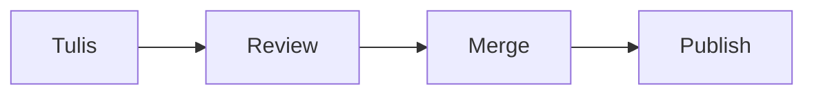
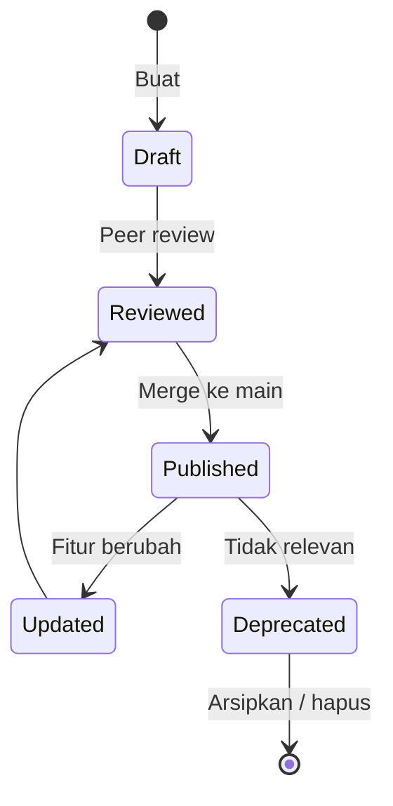

# Documentation Principles

Panduan menulis dan mengelola dokumentasi teknis untuk junior developer, solo developer, dan tim kecil.

## 1. Mengapa Dokumentasi Penting

| Fungsi | Tanpa Dokumentasi | Dengan Dokumentasi |
|---|---|---|
| **Onboarding** | Developer baru butuh berminggu-minggu memahami codebase | Setup dan konteks proyek bisa dipahami dalam hitungan jam |
| **Knowledge Transfer** | Pengetahuan tersimpan di kepala satu orang (bus factor = 1) | Pengetahuan terdistribusi dan bertahan meski anggota tim berganti |
| **Debugging** | Menghabiskan waktu reverse-engineering keputusan lama | Architecture Decision Record (ADR) menjelaskan *mengapa* kode ditulis demikian |
| **Kolaborasi** | Miskomunikasi antar developer dan stakeholder | Spesifikasi dan kontrak API menjadi sumber kebenaran tunggal |

## 2. Pendekatan Docs-as-Code

Dokumentasi diperlakukan sama seperti source code:

- **Version control** — Disimpan dalam Git bersama proyek, bukan di Google Docs terpisah.
- **Format teks terbuka** — Ditulis dalam Markdown (`.md`), bisa di-diff dan di-merge.
- **Review via Pull Request** — Perubahan dokumentasi ditinjau sama seperti perubahan kode.
- **CI validation** — Link checker dan linter (`markdownlint`) dijalankan otomatis di pipeline.
- **Single source of truth** — Satu lokasi kanonik per topik, hindari duplikasi.

## 3. Diátaxis Framework

Framework dari Daniele Procida untuk mengategorikan dokumentasi berdasarkan kebutuhan pembaca.

```
                    BELAJAR              BEKERJA
                 (acquiring)           (applying)
              ┌────────────────┬────────────────┐
  PRAKTIS     │   TUTORIAL     │    HOW-TO      │
  (steps)     │   "Ikuti saya" │  "Lakukan ini" │
              ├────────────────┼────────────────┤
  TEORETIS    │  EXPLANATION   │   REFERENCE    │
  (knowledge) │  "Pahami ini"  │   "Lihat ini"  │
              └────────────────┴────────────────┘
```

| Tipe | Tujuan | Contoh | Kapan Digunakan |
|---|---|---|---|
| **Tutorial** | Membimbing pemula langkah demi langkah | "Getting Started: Deploy Pertama" | Onboarding, fitur baru yang kompleks |
| **How-to Guide** | Memecahkan masalah spesifik | "Cara Menambahkan Payment Gateway" | Task yang berulang, operasional |
| **Reference** | Deskripsi akurat dan lengkap | API spec, config options, CLI flags | Saat developer butuh lookup cepat |
| **Explanation** | Memberikan konteks dan *reasoning* | ADR, design rationale, trade-off analysis | Keputusan arsitektur, konsep inti |

**Aturan praktis:** Jangan campur tipe dalam satu dokumen. Tutorial yang diselipi reference membingungkan pembaca.

## 4. Prinsip Penulisan

### 4.1 Audience-Centric

Tentukan pembaca sebelum menulis. Developer, QA, product owner, dan end-user butuh kedalaman teknis yang berbeda.

### 4.2 Actionable

- Utamakan langkah konkret, diagram, dan tabel — bukan narasi panjang.
- Setiap how-to harus bisa diikuti tanpa pengetahuan implisit.
- Sertakan contoh kode yang bisa langsung dijalankan (*runnable example*).

### 4.3 Living Document

Dokumentasi usang lebih berbahaya daripada ketiadaan dokumentasi.

- Update dokumen **bersamaan** dengan perubahan fitur (dalam PR yang sama).
- Tandai dokumen yang belum divalidasi ulang dengan `> ⚠️ Belum diverifikasi sejak [tanggal]`.
- Jadwalkan review berkala (quarterly untuk reference, tiap sprint untuk how-to aktif).

### 4.4 Konsistensi Terminologi

- Definisikan istilah teknis di [Glossary](glossary.md) dan gunakan secara konsisten.
- Pilih satu istilah per konsep. Jangan bergantian antara "deploy", "release", dan "publish" jika merujuk hal yang sama.
- Gunakan template standar dari folder `templates/`.

## 5. Konvensi Markdown

### Heading

- `#` untuk judul dokumen (satu per file).
- `##` untuk section utama, `###` untuk sub-section.
- Jangan loncat level (misal `##` langsung ke `####`).

### Link

- Gunakan relative path untuk dokumen internal: `[Glossary](glossary.md)`.
- Gunakan reference-style link jika URL panjang atau dipakai berulang.

### Code Block

- Selalu sertakan language identifier: ` ```python `, ` ```yaml `, ` ```bash `.
- Untuk output terminal, gunakan ` ```text `.
- Inline code untuk nama file, variabel, dan command: `` `main.py` ``, `` `git rebase` ``.

### Tabel

- Gunakan untuk perbandingan dan data terstruktur.
- Jaga kolom tetap ringkas — pindahkan detail ke catatan kaki jika perlu.

### Diagram (Mermaid)

Gunakan Mermaid untuk diagram yang perlu ikut ter-version-control:

````markdown

````

Untuk diagram kompleks (UI mockup, system landscape), gunakan tool visual dan simpan sebagai `.png` di folder `assets/`.

## 6. Lifecycle Dokumentasi



| Fase | Aksi | Penanggung Jawab |
|---|---|---|
| **Create** | Tulis draft mengikuti template dan Diátaxis type | Author |
| **Review** | Review isi teknis, bahasa, dan kelengkapan link | Peer / Tech Lead |
| **Publish** | Merge PR, tersedia di branch `main` | Author |
| **Update** | Perbarui saat fitur berubah, dalam PR yang sama | Developer yang mengubah fitur |
| **Deprecate** | Tandai `> ⛔ DEPRECATED` dengan link ke pengganti, lalu arsipkan | Tech Lead |

## 7. Lokasi Dokumentasi

| Dokumen | Lokasi | Alasan |
|---|---|---|
| **README** | Root repository | Pintu masuk pertama: apa, mengapa, cara setup |
| **Inline comment** | Di source code | Menjelaskan *mengapa*, bukan *apa* (kode harus self-explanatory) |
| **ADR** | `docs/adr/` atau `04-technical-design/` | Keputusan arsitektur perlu konteks historis |
| **API Reference** | Generated dari code annotation (OpenAPI, JSDoc) | Single source of truth, selalu sinkron dengan kode |
| **How-to / Tutorial** | Playbook atau `docs/` di repository | Panduan operasional yang diikuti berulang |
| **Playbook** | Repository terpisah (seperti repo ini) | Standar dan prinsip lintas proyek |
| **Wiki** | GitHub/GitLab Wiki | Catatan sementara, meeting notes — bukan dokumentasi kanonik |
| **CHANGELOG** | Root repository | Riwayat perubahan per release, ikuti format [Keep a Changelog](https://keepachangelog.com) |

## 8. Decision Table: Jenis Dokumen per Kebutuhan

| Saya perlu... | Tipe Diátaxis | Format | Lokasi |
|---|---|---|---|
| Memandu developer baru setup environment | Tutorial | Markdown step-by-step | README / `docs/getting-started.md` |
| Mendokumentasikan endpoint API | Reference | OpenAPI spec + generated docs | `docs/api/` atau auto-generated |
| Menjelaskan mengapa memilih PostgreSQL bukan MongoDB | Explanation | ADR | `docs/adr/` |
| Memberikan langkah rollback database | How-to | Markdown checklist | Playbook / runbook |
| Mencatat definisi istilah proyek | Reference | Glossary | `00-foundations/glossary.md` |
| Menjelaskan alur CI/CD pipeline | Explanation + diagram | Markdown + Mermaid | `docs/` atau playbook |

## 9. Anti-Pattern yang Harus Dihindari

| Anti-Pattern | Gejala | Solusi |
|---|---|---|
| **Stale docs** | Dokumen tidak diupdate saat fitur berubah | Wajibkan update dokumen dalam Definition of Done |
| **Write-only docs** | Ditulis sekali, tidak pernah dibaca | Tanya: siapa yang akan membaca ini? Jika tidak ada, jangan tulis |
| **Over-documentation** | Mendokumentasikan hal yang sudah jelas dari kode | Tulis *mengapa*, bukan *apa*. Kode yang baik adalah dokumentasi terbaik |
| **Scattered docs** | Informasi tersebar di Slack, email, wiki, dan Google Docs | Satu lokasi kanonik per topik, redirect dari tempat lain |
| **Copy-paste docs** | Informasi yang sama di beberapa tempat, cepat tidak sinkron | Single source of truth, gunakan link ke sumber kanonik |
| **No-audience docs** | Ditulis tanpa tahu siapa pembacanya | Tentukan persona pembaca di awal setiap dokumen |
| **Screenshot-heavy docs** | Screenshot UI yang cepat usang | Gunakan teks deskriptif + screenshot hanya jika benar-benar perlu |

## 10. Checklist Dokumentasi Minimum

Untuk setiap repository, pastikan minimal ada:

- [ ] **README** — deskripsi proyek, cara setup, cara menjalankan
- [ ] **CHANGELOG** — riwayat perubahan tiap release
- [ ] **Inline comments** — pada logic yang tidak obvious
- [ ] **API docs** — jika ada API, minimal OpenAPI spec atau endpoint list
- [ ] **ADR** — untuk setiap keputusan arsitektur yang signifikan

---

## Dokumen Terkait

- [Glossary](glossary.md) — Definisi istilah teknis
- [Software Engineering Principles](software-engineering-principles.md) — Prinsip rekayasa perangkat lunak
- [Git & GitHub Workflow](git-and-github-workflow.md) — Alur kerja version control
- [Architecture Decision Records](../04-technical-design/architecture-decision-records.md) — Panduan menulis ADR
- [Code Review](../checklists/code-review.md) — Checklist review termasuk review dokumentasi
- [Templates](../templates/README.md) — Template standar untuk berbagai dokumen
