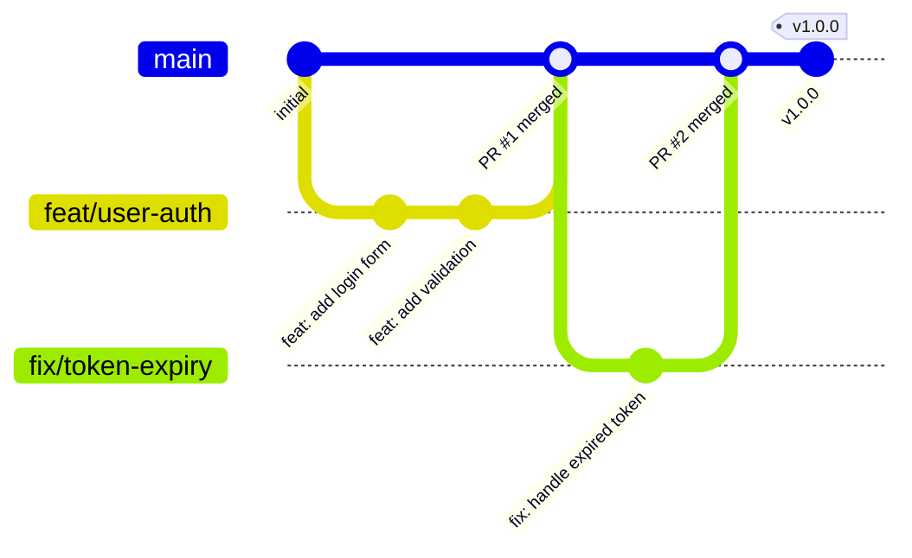

# Git dan GitHub Workflow

Panduan praktis version control dengan Git dan GitHub untuk developer pemula, solo dev, maupun tim kecil.

## 1. Perintah Dasar Git

```bash
# Inisialisasi repository baru
git init

# Clone repository yang sudah ada
git clone https://github.com/user/repo.git

# Cek status perubahan file
git status

# Stage file tertentu atau semua perubahan
git add nama-file.txt
git add .

# Commit perubahan dengan pesan
git commit -m "feat(auth): tambah login endpoint"

# Push branch ke remote
git push origin nama-branch

# Pull perubahan terbaru dari remote
git pull origin main

# Merge branch lain ke branch aktif
git merge nama-branch

# Rebase branch aktif di atas branch lain (histori linier)
git rebase main
```

## 2. Strategi Branching

### Perbandingan

| Aspek | GitHub Flow | Git Flow | Trunk-Based |
|---|---|---|---|
| **Branch utama** | `main` saja | `main` + `develop` | `main` saja |
| **Kompleksitas** | Rendah | Tinggi | Rendah |
| **Cocok untuk** | SaaS, continuous deployment | Rilis terjadwal, mobile app | Tim berpengalaman, CI/CD matang |
| **Release** | Setiap merge ke `main` | Lewat branch `release/*` | Setiap commit ke `main` |
| **Hotfix** | Branch dari `main`, merge ke `main` | Branch `hotfix/*`, merge ke `main` + `develop` | Commit langsung ke `main` (dengan feature flag) |

### Rekomendasi

- **Solo dev / proyek kecil:** GitHub Flow. Sederhana, satu branch utama.
- **Tim kecil (2-5 orang):** GitHub Flow dengan branch protection.
- **Produk dengan rilis terjadwal:** Git Flow.
- **Tim berpengalaman dengan CI/CD matang:** Trunk-Based Development.

### Diagram: GitHub Flow



## 3. Konvensi Penamaan Branch

Format: `<type>/<deskripsi-singkat>`

| Prefix | Kegunaan | Contoh |
|---|---|---|
| `feat/` | Fitur baru | `feat/user-registration` |
| `fix/` | Perbaikan bug | `fix/login-timeout` |
| `refactor/` | Restrukturisasi kode tanpa ubah perilaku | `refactor/simplify-auth-logic` |
| `docs/` | Perubahan dokumentasi | `docs/update-api-readme` |
| `chore/` | Maintenance, dependency, CI/CD | `chore/upgrade-node-20` |
| `test/` | Penambahan atau perbaikan test | `test/add-payment-tests` |
| `hotfix/` | Perbaikan darurat di production | `hotfix/fix-crash-on-checkout` |

Gunakan huruf kecil, pisahkan kata dengan `-`. Hindari nama generik seperti `fix/bug` atau `feat/update`.

## 4. Conventional Commits

### Format

```
<type>(<scope>): <subject>

[optional body]

[optional footer(s)]
```

- **type**: Jenis perubahan (wajib).
- **scope**: Area kode yang terdampak (opsional). Contoh: `auth`, `billing`, `api`.
- **subject**: Deskripsi singkat, huruf kecil, tanpa titik di akhir (wajib).
- **body**: Penjelasan detail jika diperlukan (opsional).
- **footer**: Referensi issue, breaking changes (opsional).

### Tipe Commit

| Type | Kapan Digunakan |
|---|---|
| `feat` | Menambah fitur baru |
| `fix` | Memperbaiki bug |
| `docs` | Perubahan dokumentasi saja |
| `style` | Formatting, semicolons, tanpa perubahan logika |
| `refactor` | Ubah struktur kode tanpa ubah perilaku |
| `test` | Tambah atau perbaiki test |
| `chore` | Build, CI, dependency |
| `perf` | Peningkatan performa |
| `ci` | Perubahan konfigurasi CI/CD |

### Contoh

```bash
# Fitur baru
git commit -m "feat(cart): tambah fitur apply voucher"

# Bug fix dengan referensi issue
git commit -m "fix(payment): handle null response dari payment gateway

Closes #42"

# Breaking change
git commit -m "feat(api)!: ubah format response pagination

BREAKING CHANGE: field 'total_page' diganti menjadi 'totalPages'"

# Chore
git commit -m "chore(deps): upgrade express ke v5"
```

## 5. Pull Request Workflow

### Membuat PR

```bash
# Buat branch, kerjakan, push
git checkout -b feat/order-history
# ... kerjakan perubahan ...
git add .
git commit -m "feat(order): tampilkan order history"
git push origin feat/order-history
# Buka GitHub → Create Pull Request
```

### Template Deskripsi PR

```markdown
## Ringkasan
Deskripsi singkat perubahan dan alasannya.

## Tipe Perubahan
- [ ] Fitur baru
- [ ] Bug fix
- [ ] Refactor
- [ ] Dokumentasi

## Issue Terkait
Closes #__

## Cara Pengujian
1. Jalankan `npm run dev`
2. Buka halaman /orders
3. Verifikasi daftar order muncul

## Screenshot (jika ada perubahan UI)

## Checklist
- [ ] Kode sudah di-lint dan lolos semua test
- [ ] Tidak ada console.log / debugger tertinggal
- [ ] Dokumentasi diperbarui (jika perlu)
```

### Proses Review

1. **Buat PR** — Ukuran ideal < 400 baris perubahan kode. Satu PR = satu concern.
2. **CI checks** — Lint, test, build harus lolos (status hijau).
3. **Review** — Minimal 1 approval dari reviewer.
4. **Perbaiki feedback** — Push commit tambahan ke branch yang sama.
5. **Merge** — Setelah approved dan CI hijau.

### Merge Strategies

| Strategi | Cara Kerja | Kapan Digunakan |
|---|---|---|
| **Squash and Merge** | Semua commit di-squash jadi 1 commit | Default. Histori `main` bersih dan linier. |
| **Merge Commit** | Buat merge commit, semua commit asli dipertahankan | Perlu histori lengkap per PR. |
| **Rebase and Merge** | Rebase commit di atas `main`, tanpa merge commit | Histori linier tanpa squash. |

**Rekomendasi:** Squash and Merge untuk kebanyakan kasus. Histori di `main` bersih, satu commit = satu PR.

## 6. Issue Tracking dengan GitHub Issues

```markdown
# Contoh issue yang baik:
## Title: [BUG] Halaman checkout crash saat voucher expired

**Deskripsi:** Aplikasi crash dengan error "Cannot read property 'discount' of null"
saat user apply voucher yang sudah expired.

**Langkah Reproduksi:**
1. Tambah item ke cart
2. Apply voucher code "EXPIRED2024"
3. Klik "Checkout"

**Expected:** Tampilkan pesan error "Voucher sudah tidak berlaku"
**Actual:** Halaman crash, white screen

**Environment:** Chrome 120, Production
```

Gunakan **Labels** (`bug`, `enhancement`, `documentation`, `good first issue`) dan **Milestones** untuk organisasi. Hubungkan issue ke PR dengan keyword `Closes #123` di commit atau deskripsi PR.

## 7. Git Tags untuk Release

```bash
# Buat annotated tag
git tag -a v1.0.0 -m "Release v1.0.0: fitur order dan payment"

# Push tag ke remote
git push origin v1.0.0

# Push semua tag
git push origin --tags

# Lihat daftar tag
git tag -l

# Hapus tag (lokal dan remote)
git tag -d v1.0.0
git push origin --delete v1.0.0
```

Gunakan [Semantic Versioning](https://semver.org/): `vMAJOR.MINOR.PATCH`.
- **MAJOR**: Breaking changes.
- **MINOR**: Fitur baru, backward compatible.
- **PATCH**: Bug fix.

Buat **GitHub Release** dari tag untuk changelog dan distribusi artifact.

## 8. `.gitignore` Best Practices

```gitignore
# Dependencies
node_modules/
vendor/
.venv/

# Build output
dist/
build/
*.exe

# Environment & secrets — JANGAN PERNAH commit
.env
.env.local
*.pem
*.key

# IDE & OS
.vscode/settings.json
.idea/
*.swp
.DS_Store
Thumbs.db

# Logs & cache
*.log
.cache/
coverage/
```

**Aturan penting:**
- Buat `.gitignore` **sebelum commit pertama**.
- Jangan commit file environment, secret, atau credential. Sekali masuk histori Git, sulit dihapus sepenuhnya.
- Gunakan [gitignore.io](https://www.toptal.com/developers/gitignore) untuk generate template sesuai stack.
- Jika file sudah terlanjur ter-commit: `git rm --cached nama-file` lalu tambahkan ke `.gitignore`.

## 9. Solo Dev vs Tim

| Aspek | Solo Dev | Tim |
|---|---|---|
| **Branching** | Boleh commit langsung ke `main` untuk perubahan kecil | Selalu gunakan feature branch + PR |
| **Review** | Self-review sebelum merge | Wajib peer review, minimal 1 approval |
| **Branch protection** | Opsional | Wajib: require PR, require CI pass |
| **Commit style** | Conventional Commits tetap berguna untuk histori | Wajib Conventional Commits |
| **Merge strategy** | Bebas, tapi konsisten | Sepakati satu strategi (rekomendasi: Squash) |
| **Issue tracking** | Opsional, tapi baik untuk tracking backlog | Wajib, setiap task punya issue |

Solo dev tetap disarankan menggunakan branch untuk fitur besar. Kebiasaan baik di proyek solo mempermudah transisi ke kerja tim.

## 10. Kesalahan Umum dan Cara Menghindari

### Force Push ke Branch Shared

```bash
# JANGAN lakukan ini di main atau branch yang dikerjakan orang lain
git push --force origin main  # ❌

# Gunakan force-with-lease jika terpaksa rebase feature branch sendiri
git push --force-with-lease origin feat/my-feature  # ✅
```

### Commit Terlalu Besar

Satu commit berisi 20 file dari 3 fitur berbeda — sulit di-review, sulit di-revert. Pecah jadi commit atomic: satu commit = satu perubahan logis.

### Tidak Punya `.gitignore`

`node_modules/` atau `.env` ter-commit ke repository. Buat `.gitignore` sebelum `git add .` pertama.

### Merge Conflict

```bash
# Pull terbaru sebelum mulai kerja
git pull origin main

# Rebase feature branch secara berkala agar tidak jauh tertinggal
git checkout feat/my-feature
git rebase main
# Resolve conflict jika ada, lalu:
git rebase --continue
```

### Commit Secret atau Credential

Jika sudah terlanjur: rotasi secret tersebut **segera**. Hapus dari histori dengan `git filter-branch` atau [BFG Repo-Cleaner](https://rtyley.github.io/bfg-repo-cleaner/). Pencegahan: gunakan `.env` + `.gitignore`, dan aktifkan GitHub Secret Scanning.

### Pesan Commit Tidak Jelas

```bash
# Buruk
git commit -m "fix"
git commit -m "update"
git commit -m "wip"

# Baik
git commit -m "fix(auth): handle token refresh saat session expired"
```

## Dokumen Terkait

- [Software Development Lifecycle](./software-development-lifecycle.md)
- [Documentation Principles](./documentation-principles.md)
- [Software Engineering Principles](./software-engineering-principles.md)
