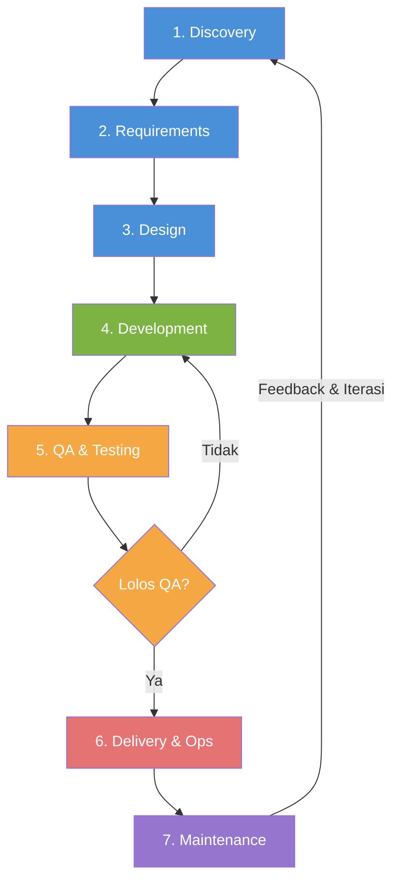

# Software Development Lifecycle (SDLC)

## 1. Apa Itu SDLC?

SDLC (*Software Development Lifecycle*) adalah kerangka kerja yang mendefinisikan **fase-fase** dalam membangun perangkat lunak — dari identifikasi masalah hingga maintenance di production. Bukan metodologi tunggal, melainkan struktur umum yang bisa dijalankan dengan model berbeda (Waterfall, Agile, Spiral, dll).

Tanpa SDLC yang jelas:

- Scope membengkak karena tidak ada batasan fase
- Bug ditemukan terlambat (makin lambat, makin mahal)
- Handoff antar peran (PM → Dev → QA) menjadi chaotic
- Estimasi tidak punya dasar — selalu meleset

SDLC bukan birokrasi. Untuk solo dev sekalipun, checklist sederhana per fase sudah mengurangi risiko rework secara signifikan.

---

## 2. Fase-Fase SDLC

Setiap model SDLC mengandung fase-fase inti yang sama. Yang berbeda adalah **urutan, iterasi, dan formalitas** antar fase.

| # | Fase | Input | Aktivitas Kunci | Output | Folder Playbook |
|---|------|-------|-----------------|--------|-----------------|
| 1 | **Discovery** | Kebutuhan bisnis, pain points pengguna | Riset masalah, analisis stakeholder, studi kelayakan, competitive analysis | Discovery Notes, Feasibility Matrix, Project Charter | [`01-project-discovery`](../01-project-discovery/README.md) |
| 2 | **Requirements** | Catatan discovery yang tervalidasi | Penulisan PRD, user stories, use cases, acceptance criteria, business rules | PRD, Functional Specs, User Story Map | [`02-product-requirements`](../02-product-requirements/README.md) |
| 3 | **Design** | PRD yang disetujui stakeholder | UX research, wireframe, UI mockup, design system, arsitektur sistem, ADR, API design, data modeling | Architecture Doc, ADR, Data Dictionary, Figma Specs, API Contract | [`03-ux-ui-design`](../03-ux-ui-design/README.md), [`04-technical-design`](../04-technical-design/README.md) |
| 4 | **Development** | Design specs, user stories yang memenuhi DoR | Sprint planning, coding, unit testing, code review, CI pipeline | Source code teruji, build artifacts, API terintegrasi | [`05-development-practices`](../05-development-practices/README.md) |
| 5 | **QA & Testing** | Build artifacts, test plan | Integration test, E2E test, UAT, security scan, performance test, regression | Test Report, Bug Log, QA Sign-off | [`06-quality-assurance`](../06-quality-assurance/README.md) |
| 6 | **Delivery & Ops** | Build yang lolos QA, rollback plan | Deployment, zero-downtime release, database migration, monitoring setup | Rilis live, Release Notes, Runbook | [`07-delivery-operations`](../07-delivery-operations/README.md) |
| 7 | **Maintenance** | Feedback production, metrik operasional, bug report | Bug fixing, security patching, tech debt refactoring, dependency update, retrospective | Patch release, Post-mortem, Improvement backlog | [`09-maintenance-evolution`](../09-maintenance-evolution/README.md) |

> **Catatan:** Folder [`08-project-management`](../08-project-management/README.md) bersifat *cross-cutting* — berlaku di semua fase (estimasi, risk management, decision log, stage gates).

---

## 3. Alur Lifecycle



Dalam model Agile, siklus D → E → F berputar per sprint (1-4 minggu). Dalam Waterfall, siklus berjalan sekuensial satu kali penuh.

---

## 4. Model-Model SDLC

### 4.1 Waterfall

Fase berjalan **sekuensial** — fase berikutnya dimulai setelah fase sebelumnya selesai. Tidak ada backtrack formal.

**Kapan pakai:** Requirements sudah fix dan tidak akan berubah (embedded system, regulatory compliance, kontrak fixed-price).

**Kelebihan:** Mudah dipahami, dokumentasi lengkap, progress terukur jelas.

**Kekurangan:** Feedback terlambat, perubahan mahal, risiko tinggi di akhir proyek.

### 4.2 Iterative & Incremental

Sistem dibangun dalam **beberapa siklus**. Setiap siklus menghasilkan subset fitur yang berfungsi. Requirements boleh diperbaiki antar siklus.

**Kapan pakai:** Requirements cukup jelas tapi perlu validasi bertahap (internal tools, migrasi sistem).

**Kelebihan:** Risiko lebih terkendali, feedback antar siklus, integrasi bertahap.

**Kekurangan:** Butuh perencanaan arsitektur yang matang di awal agar integrasi antar increment tidak bermasalah.

### 4.3 Agile

Umbrella term untuk pendekatan yang memprioritaskan **working software, kolaborasi, dan respons terhadap perubahan**. Dua implementasi paling umum:

- **Scrum:** Sprint 1-4 minggu dengan role tetap (Product Owner, Scrum Master, Dev Team). Cocok untuk product development dengan tim 3-9 orang.
- **Kanban:** Flow-based, tanpa sprint. Kontrol lewat WIP limit. Cocok untuk maintenance, support, atau tim yang handle banyak request paralel.

**Kapan pakai:** Requirements belum pasti, butuh feedback cepat, produk consumer-facing.

**Kelebihan:** Adaptif, delivery cepat, kolaborasi erat dengan stakeholder.

**Kekurangan:** Butuh disiplin; tanpa backlog grooming yang rutin, sprint menjadi tidak terarah. Dokumentasi bisa terabaikan jika tim tidak disiplin.

### 4.4 Spiral

Setiap siklus melewati 4 kuadran: **planning → risk analysis → engineering → evaluation**. Fokus utama pada identifikasi dan mitigasi risiko di setiap iterasi.

**Kapan pakai:** Proyek besar berisiko tinggi (sistem keuangan, healthcare, aerospace). Overhead tinggi — tidak efisien untuk proyek kecil.

**Kelebihan:** Risk management eksplisit, cocok untuk sistem kompleks.

**Kekurangan:** Proses berat, butuh expertise risk assessment, cost tinggi.

---

## 5. Perbandingan Model

| Aspek | Waterfall | Iterative | Agile (Scrum) | Agile (Kanban) | Spiral |
|-------|-----------|-----------|---------------|----------------|--------|
| **Flexibility terhadap perubahan** | Rendah | Sedang | Tinggi | Tinggi | Sedang |
| **Kejelasan requirements di awal** | Harus lengkap | Sebagian besar | Boleh evolve | Boleh evolve | Evolve per siklus |
| **Waktu ke working software** | Lama (akhir proyek) | Sedang | Cepat (tiap sprint) | Cepat (continuous) | Sedang |
| **Overhead proses** | Rendah-sedang | Sedang | Sedang (ceremony) | Rendah | Tinggi |
| **Cocok untuk tim kecil/solo** | Ya (proyek kecil) | Ya | Ya (Scrum kecil) | Ya | Tidak |
| **Risk management** | Minim | Sedang | Implicit (feedback loop) | Implicit | Eksplisit & formal |
| **Dokumentasi** | Berat | Sedang | Ringan-sedang | Minimal | Berat |
| **Contoh use case** | Firmware, sistem regulasi | Migrasi legacy | SaaS, mobile app | Bug fixing, ops | Sistem perbankan, avionics |

---

## 6. Cara Memilih Model

Tidak ada model yang selalu superior. Pilih berdasarkan konteks:

```
Requirements jelas & tidak berubah?
├── Ya → Waterfall atau Iterative
└── Tidak / belum tahu semua
    ├── Tim kecil, butuh delivery cepat → Agile (Scrum atau Kanban)
    └── Risiko tinggi, budget besar → Spiral
```

**Faktor keputusan:**

1. **Stabilitas requirements** — Makin volatile, makin butuh iterasi pendek
2. **Ukuran tim** — Tim < 5 orang jarang butuh Scrum formal; Kanban atau Iterative lebih lean
3. **Risiko proyek** — Proyek mission-critical butuh risk analysis eksplisit (Spiral)
4. **Kontrak & compliance** — Fixed-price contract dan regulasi ketat sering menuntut Waterfall
5. **Timeline** — Deadline ketat dengan scope tidak jelas → Agile dengan timeboxing

**Untuk solo dev dan tim kecil:** Mulai dengan Kanban board sederhana + fase-fase dari tabel di atas. Tambah ceremony (standup, retro) hanya kalau ada masalah komunikasi yang perlu dipecahkan.

---

## 7. Pemetaan ke Struktur Playbook

```
SDLC Fase          Folder Playbook              Gate
─────────────────────────────────────────────────────────
Discovery       →  01-project-discovery/     →  Gate 1: Problem terdefinisi
Requirements    →  02-product-requirements/  →  Gate 2: PRD & specs signed off
Design (UX/UI)  →  03-ux-ui-design/          │
Design (Tech)   →  04-technical-design/      →  Gate 3: Ready for dev (DoR)
Development     →  05-development-practices/ │
QA & Testing    →  06-quality-assurance/     →  Gate 4: Release readiness (DoD)
Delivery & Ops  →  07-delivery-operations/   →  Go-live
Management      →  08-project-management/    →  (cross-cutting, semua fase)
Maintenance     →  09-maintenance-evolution/ →  Post-release review
```

Gunakan [checklists](../checklists/README.md) di setiap gate untuk memastikan kesiapan sebelum pindah fase.

---

## 8. Kesalahan Umum

| Kesalahan | Dampak | Solusi |
|-----------|--------|--------|
| Skip discovery, langsung coding | Membangun solusi untuk masalah yang salah | Minimal 1-2 hari discovery, walau informal |
| Requirements tidak tertulis | Scope creep, debat tanpa rujukan | Tulis user stories atau bullet points sederhana — tidak harus PRD formal |
| Tidak ada Definition of Done | QA dan Dev punya standar berbeda, rilis tidak konsisten | Sepakati DoD di awal, review tiap retrospective |
| Pilih Scrum tapi skip retrospective | Masalah proses tidak pernah diperbaiki | Retro adalah ceremony paling penting di Scrum — jangan skip |
| Waterfall untuk produk baru consumer-facing | Feedback terlambat, fitur tidak dipakai user | Pakai Agile; rilis MVP dulu, iterasi dari feedback |
| Over-engineering proses untuk tim kecil | Waktu habis di meeting dan dokumentasi | Sesuaikan formalitas dengan ukuran tim; 2 orang tidak butuh daily standup |
| Tidak ada automated testing di CI | Bug lolos ke production berulang kali | Mulai dari unit test untuk business logic kritis |
| Deployment manual tanpa rollback plan | Downtime panjang saat ada masalah rilis | Setup CI/CD minimal; siapkan rollback script sebelum deploy |

---

## 9. Dokumen Terkait

- [Software Engineering Principles](software-engineering-principles.md) — Prinsip desain dan coding
- [Project Discovery](../01-project-discovery/README.md) — Panduan fase discovery
- [Product Requirements](../02-product-requirements/README.md) — Cara menulis PRD dan user stories
- [UX/UI Design](../03-ux-ui-design/README.md) — Proses desain dan design system
- [Technical Design](../04-technical-design/README.md) — Arsitektur, ADR, dan API design
- [Development Practices](../05-development-practices/README.md) — Standar coding dan code review
- [Quality Assurance](../06-quality-assurance/README.md) — Strategi testing dan bug reporting
- [Delivery & Operations](../07-delivery-operations/README.md) — CI/CD, deployment, dan monitoring
- [Project Management](../08-project-management/README.md) — Estimasi, risk management, dan stage gates
- [Maintenance & Evolution](../09-maintenance-evolution/README.md) — Tech debt dan post-release review
- [Stage Gate Process](../08-project-management/stage-gate-process.md) — Detail proses gate review
- [Checklists](../checklists/README.md) — Daftar periksa kesiapan per fase
