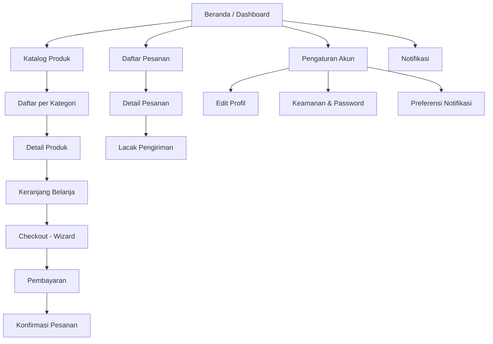

# Information Architecture (IA)

## 1. Apa Itu Information Architecture?

Information Architecture (IA) adalah praktik mengorganisir, menstruktur, dan melabeli konten dalam produk digital sehingga pengguna dapat menemukan informasi dan menyelesaikan tugas secara efisien.

IA bukan soal tampilan visual — IA adalah **kerangka struktural** yang menentukan:
- Di mana konten ditempatkan
- Bagaimana halaman saling terhubung
- Label apa yang digunakan untuk navigasi
- Bagaimana pengguna berpindah dari titik A ke titik B

> **Analogi:** IA adalah denah lantai sebuah gedung. Tanpa denah yang baik, pengguna tersesat walau interiornya indah.

## 2. Mengapa IA Penting?

| Tanpa IA yang Baik | Dengan IA yang Baik |
|---|---|
| Pengguna bingung mencari fitur | Navigasi intuitif, task completion tinggi |
| Menu navigasi membengkak | Struktur menu bersih dan terkelompok logis |
| Developer bingung routing | Sitemap jelas, URL structure konsisten |
| Fitur baru sulit ditempatkan | Struktur scalable, penambahan fitur terencana |

## 3. Navigation Patterns

### 3.1 Hierarchical (Tree)

Navigasi bertingkat dari kategori luas ke detail spesifik.

**Kapan pakai:** Aplikasi dengan banyak konten terstruktur — e-commerce, CMS, portal dokumentasi.

```
Beranda
├── Produk
│   ├── Kategori A
│   │   ├── Produk Detail
│   │   └── Produk Detail
│   └── Kategori B
├── Pesanan
│   ├── Riwayat
│   └── Detail Pesanan
└── Pengaturan
```

**Kelebihan:** Familiar, scalable untuk konten besar.
**Kelemahan:** Jika terlalu dalam (>3 level), pengguna kehilangan orientasi.

### 3.2 Hub and Spoke

Satu halaman sentral (hub) mengarah ke berbagai area independen (spoke). Setiap spoke tidak saling terhubung langsung — pengguna selalu kembali ke hub.

**Kapan pakai:** Dashboard analytics, aplikasi mobile dengan fitur independen, settings panel.

**Kelebihan:** Sederhana, fokus satu tugas per spoke.
**Kelemahan:** Tidak efisien jika pengguna perlu berpindah antar spoke secara cepat.

### 3.3 Flat (Lateral)

Semua halaman utama setara dan dapat diakses langsung dari navigasi utama. Tidak ada hierarki bertingkat.

**Kapan pakai:** Aplikasi kecil (<10 halaman), portfolio, landing page multi-section.

**Kelebihan:** Cepat diakses, navigasi minimal.
**Kelemahan:** Tidak scalable — navigasi membengkak jika halaman bertambah.

### 3.4 Wizard (Linear / Sequential)

Alur langkah-demi-langkah berurutan. Pengguna harus menyelesaikan step N sebelum ke step N+1.

**Kapan pakai:** Checkout e-commerce, onboarding, form multi-step, setup wizard.

**Kelebihan:** Mengurangi cognitive load, pengguna tahu progress mereka.
**Kelemahan:** Tidak fleksibel — pengguna tidak bisa loncat ke langkah tertentu.

### 3.5 Panduan Pemilihan Pattern

| Situasi | Pattern |
|---|---|
| Konten banyak, bervariasi, perlu kategori | Hierarchical |
| Fitur independen, pengguna fokus satu tugas | Hub and Spoke |
| Aplikasi kecil, semua fitur setara | Flat |
| Proses berurutan yang harus tuntas | Wizard |
| Aplikasi kompleks | Kombinasi (misal: Hierarchical + Wizard untuk checkout) |

## 4. Sitemap: Peta Struktur Aplikasi

Sitemap adalah diagram visual yang menunjukkan semua halaman dan hubungan antar halaman.

### Contoh Sitemap (Mermaid)



### Tips Membuat Sitemap

- Mulai dari **halaman utama** yang paling sering diakses
- Batasi kedalaman maksimal **3 level** untuk navigasi utama
- Tandai halaman yang memerlukan **autentikasi**
- Tandai alur **wizard/linear** dengan penomoran step
- Review sitemap bersama developer untuk validasi routing

## 5. Content Organization: Metode Riset

### 5.1 Card Sorting

Minta pengguna mengelompokkan item konten ke dalam kategori yang menurut mereka logis.

- **Open card sort:** Pengguna buat kategori sendiri — untuk discovery
- **Closed card sort:** Kategori sudah ditentukan, pengguna assign item — untuk validasi

**Tools gratis:** OptimalSort (free tier), spreadsheet + sticky notes fisik.

### 5.2 Tree Testing

Validasi apakah pengguna bisa menemukan item dalam struktur navigasi yang sudah dirancang, **tanpa bantuan visual UI**.

**Cara sederhana:** Tulis struktur navigasi di dokumen teks, minta 5 orang temukan item tertentu. Catat success rate.

## 6. Labeling dan Taxonomy

Label navigasi adalah kata-kata yang digunakan pada menu, tab, breadcrumb, dan link.

### Prinsip Labeling

| Prinsip | Contoh Baik | Contoh Buruk |
|---|---|---|
| Gunakan bahasa pengguna, bukan istilah internal | "Pesanan Saya" | "Transaction Module" |
| Spesifik dan deskriptif | "Riwayat Pembayaran" | "Data" |
| Konsisten — satu konsep satu label | Selalu "Keranjang" | Berganti "Cart", "Tas Belanja", "Keranjang" |
| Singkat — 1-3 kata untuk navigasi | "Pengaturan" | "Halaman Pengaturan Akun Pengguna" |
| Hindari jargon teknis | "Bantuan" | "Knowledge Base" |

### Taxonomy

Taxonomy adalah sistem klasifikasi hierarkis untuk konten. Contoh taxonomy produk:

```
Elektronik
├── Smartphone
│   ├── Android
│   └── iOS
├── Laptop
│   ├── Gaming
│   └── Ultrabook
└── Aksesoris
    ├── Charger
    └── Case
```

Pastikan taxonomy **mutually exclusive** (satu item di satu kategori) dan **collectively exhaustive** (semua item tercakup).

## 7. IA untuk Berbagai Tipe Proyek

| Tipe Proyek | Fokus IA |
|---|---|
| **E-commerce** | Taxonomy produk, search/filter, checkout wizard |
| **SaaS Dashboard** | Hub-spoke, sidebar navigation, role-based menu |
| **Content/Blog** | Tag/category taxonomy, search, chronological vs topical |
| **Mobile App** | Bottom tab bar (max 5 item), gesture navigation |
| **Internal Tool** | Task-based grouping, minimal nesting, quick access |

## 8. Kesalahan Umum

| Kesalahan | Dampak | Solusi |
|---|---|---|
| Navigasi terlalu dalam (>4 level) | Pengguna tersesat, bounce rate tinggi | Flatten — maksimal 3 level |
| Label berdasarkan struktur organisasi internal | Pengguna tidak paham "Divisi Operasional" | Gunakan bahasa pengguna |
| Tidak ada search untuk konten banyak | Pengguna frustasi mencari manual | Tambah search + filter |
| Sitemap tidak diupdate saat fitur bertambah | Developer dan designer tidak sinkron | Review sitemap tiap sprint |
| Satu item di banyak kategori tanpa jelas | Pengguna bingung "ini di mana?" | Satu lokasi utama, cross-link jika perlu |
| Tidak melibatkan pengguna (skip card sorting) | Struktur masuk akal untuk tim, bukan pengguna | Lakukan minimal tree testing |

## 9. Dokumen Terkait

- [User Flows](user-flows.md) — Alur interaksi pengguna dalam struktur IA
- [Wireframes and Prototypes](wireframes-and-prototypes.md) — Visualisasi tata letak navigasi
- [UI Specification](ui-specification.md) — Detail grid dan breakpoints navigasi responsif
- [Design System](design-system.md) — Komponen navigasi (sidebar, tab bar, breadcrumb)
