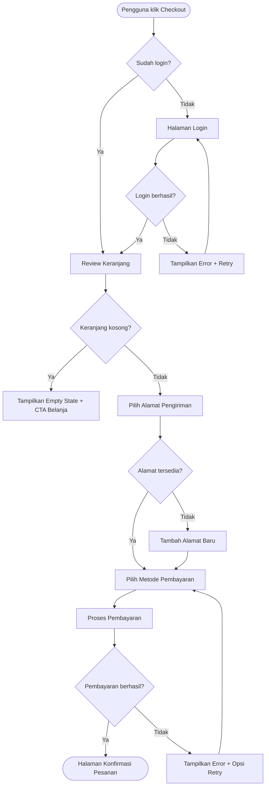

# User Flows

## 1. Definisi dan Perbedaan

### User Flow
Diagram yang menunjukkan **seluruh perjalanan pengguna** untuk menyelesaikan sebuah goal, termasuk halaman yang dikunjungi, tindakan yang dilakukan, dan keputusan yang diambil.

Contoh: "Pengguna baru mendaftar akun, verifikasi email, dan melakukan pembelian pertama."

### Task Flow
Diagram yang menunjukkan **satu tugas spesifik** tanpa variasi pengguna — mengasumsikan satu jalur linear. Tidak ada titik keputusan.

Contoh: "Reset password" — satu jalur: klik lupa password → isi email → buka link → buat password baru.

### Wireflow
Kombinasi **user flow + wireframe** — diagram alir yang menggunakan screenshot atau wireframe mini sebagai node, bukan kotak teks.

Berguna untuk menunjukkan konteks visual di setiap langkah.

| Jenis | Kapan Pakai | Tingkat Detail |
|---|---|---|
| Task Flow | Satu tugas linear tanpa variasi | Rendah |
| User Flow | Perjalanan lengkap dengan decision points | Sedang |
| Wireflow | Perlu konteks visual tiap langkah | Tinggi |

## 2. Mengapa Membuat User Flow?

- **Menemukan gap** — edge case dan error path terlihat sebelum coding
- **Alignment tim** — designer, developer, PM punya pemahaman sama tentang alur
- **Estimasi akurat** — developer bisa lihat jumlah halaman, state, dan kondisi
- **Dasar testing** — QA bisa buat test case dari setiap cabang flow
- **Dokumentasi hidup** — onboarding developer baru lebih cepat

## 3. Notasi Diagram

| Simbol | Bentuk | Kegunaan |
|---|---|---|
| **Start / End** | Oval / Rounded rectangle | Titik mulai dan selesai alur |
| **Action / Screen** | Rectangle | Tindakan pengguna atau halaman yang ditampilkan |
| **Decision** | Diamond | Percabangan berdasarkan kondisi (Ya/Tidak) |
| **Arrow** | Garis berpanah | Arah aliran — selalu satu arah per garis |
| **Annotation** | Catatan kecil | Penjelasan tambahan di samping node |

Konvensi warna (opsional tapi membantu):
- 🟢 Hijau: Happy path
- 🔴 Merah: Error / exception path
- 🟡 Kuning: Alternative path
- ⚪ Abu-abu: System action (bukan user action)

## 4. Langkah Membuat User Flow

### Step 1: Tentukan Goal Pengguna
Mulai dari satu goal spesifik, bukan fitur.

❌ "Fitur checkout" → terlalu luas
✅ "Pengguna menyelesaikan pembayaran dengan transfer bank" → spesifik

### Step 2: Identifikasi Entry Point
Dari mana pengguna memulai? Bisa dari:
- Halaman utama
- Deep link / notifikasi
- Email / link eksternal
- Redirect dari halaman lain

### Step 3: Gambar Happy Path Dulu
Jalur paling ideal — semua berjalan lancar, tidak ada error.

### Step 4: Tambahkan Decision Points
Di setiap langkah, tanyakan: "Apa yang bisa berbeda di sini?"
- Sudah login atau belum?
- Data valid atau tidak?
- Koneksi stabil atau putus?
- Punya izin akses atau tidak?

### Step 5: Gambar Alternative dan Exception Paths
- **Alternative:** Jalur valid lain (bayar via e-wallet vs transfer bank)
- **Exception:** Jalur error (saldo tidak cukup, session expired, server error)

### Step 6: Pastikan Tidak Ada Dead End
Setiap cabang harus punya **jalan keluar** — baik kembali ke flow utama atau menuju halaman error dengan CTA retry/kembali.

## 5. Tipe Flow: Happy, Alternative, Exception

### Happy Path
Alur sukses tanpa hambatan — baseline flow yang harus bekerja sempurna.

### Alternative Path
Jalur valid lain yang tetap mencapai goal:
- Login via Google alih-alih email/password
- Pilih metode pembayaran berbeda
- Skip langkah opsional

### Exception Path
Alur saat terjadi kegagalan — **WAJIB didokumentasikan**:
- Validasi gagal (email format salah, password terlalu pendek)
- Network error / timeout
- Session expired
- Insufficient permissions (role tidak sesuai)
- Rate limit / quota exceeded
- Data not found (404)

## 6. Contoh User Flow (Mermaid)

### Checkout E-commerce



## 7. Format Dokumentasi User Flow

Setiap user flow yang didokumentasikan harus mencakup:

```markdown
## Flow: [Nama Flow]

**Goal:** [Apa yang ingin dicapai pengguna]
**Actor:** [Tipe pengguna — guest, member, admin]
**Entry Point:** [Dari mana pengguna memulai]
**Precondition:** [Syarat sebelum flow dimulai]

### Happy Path
1. [Langkah 1]
2. [Langkah 2]
3. ...

### Alternative Paths
- **Alt-1:** [Deskripsi jalur alternatif]

### Exception Paths
- **Err-1:** [Kondisi error] → [Apa yang ditampilkan] → [Recovery action]
- **Err-2:** ...

### Exit Points
- **Sukses:** [Halaman/state akhir jika berhasil]
- **Gagal:** [Halaman/state akhir jika gagal]

### Diagram
[Link ke diagram Mermaid atau Figma]
```

## 8. Kesalahan Umum

| Kesalahan | Dampak | Solusi |
|---|---|---|
| Hanya gambar happy path | Error case tidak tertangani, UX buruk saat gagal | Selalu mapping minimal 3 exception paths |
| Terlalu granular (setiap klik jadi node) | Diagram tidak terbaca, maintenance berat | Satu node = satu keputusan atau satu halaman, bukan satu klik |
| Tidak ada entry point yang jelas | Developer bingung routing dari mana | Tandai semua possible entry points |
| Dead end — cabang tanpa jalan keluar | Pengguna stuck, harus refresh manual | Audit: setiap terminal node harus ada CTA |
| Flow tidak diupdate setelah perubahan requirement | Dokumentasi menyesatkan | Review flow setiap sprint planning |
| Mencampur system logic dan user action | Diagram membingungkan | Bedakan warna/bentuk untuk system vs user action |
| Tidak mempertimbangkan state pengguna | Alur berbeda untuk user baru vs returning | Buat flow terpisah per persona jika berbeda signifikan |

## 9. Dokumen Terkait

- [Information Architecture](information-architecture.md) — Struktur navigasi yang jadi kerangka flow
- [Wireframes and Prototypes](wireframes-and-prototypes.md) — Visualisasi setiap halaman dalam flow
- [UI States and Error Messages](ui-states-and-error-messages.md) — Detail state di setiap node flow
- [UI Specification](ui-specification.md) — Spesifikasi teknis setiap halaman
