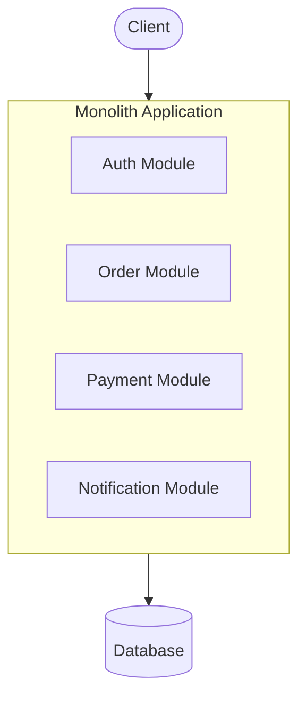
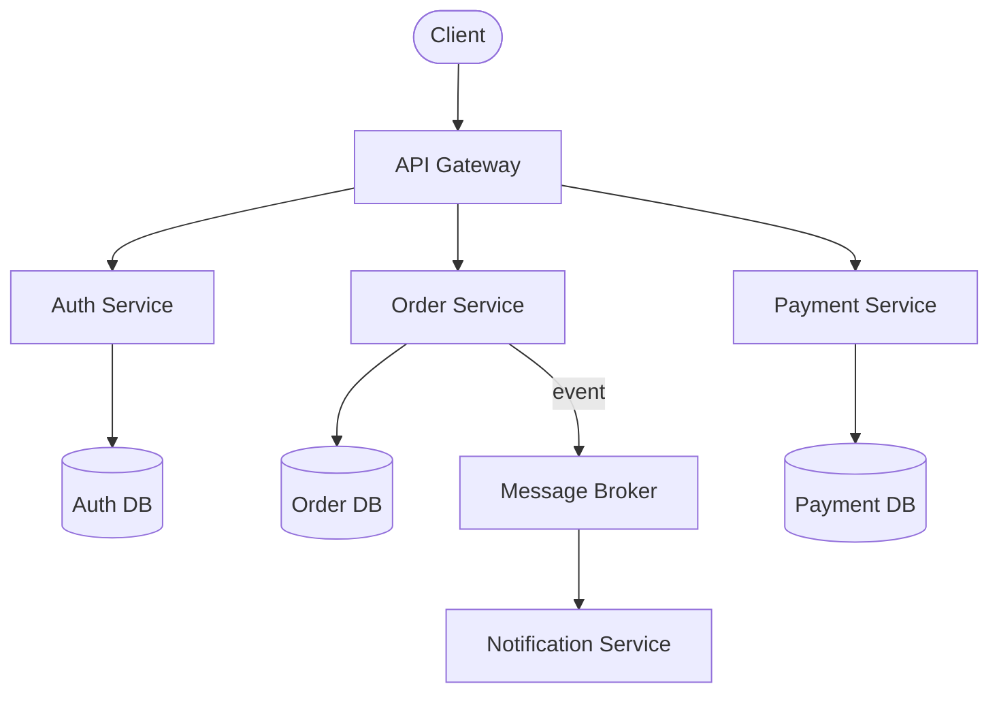

# Architecture Patterns

## 1. Mengapa Pemilihan Pattern Penting?

Architecture pattern adalah **blueprint** yang menentukan bagaimana kode diorganisasi, bagaimana komponen berkomunikasi, dan bagaimana sistem di-scale. Memilih pattern yang salah di awal bisa menyebabkan over-engineering (terlalu kompleks) atau under-engineering (tidak bisa berkembang).

**Prinsip utama:** Mulai sesederhana mungkin. Tambah kompleksitas hanya ketika ada masalah nyata, bukan masalah yang dibayangkan.

---

## 2. Perbandingan Pola Arsitektur

### Monolith

**Deskripsi:** Seluruh aplikasi dalam satu codebase, satu deployment unit. Frontend, backend, dan database access ada dalam satu proses.

| Aspek | Detail |
|---|---|
| **Kelebihan** | Deployment sederhana (satu artifact), debugging mudah (satu proses), tidak ada network latency antar-komponen, mudah dipahami |
| **Kelemahan** | Scaling hanya vertikal (seluruh app), satu bug bisa crash seluruh sistem, build time membesar seiring waktu |
| **Kapan digunakan** | Proyek baru, MVP, tim kecil (1-5 developer), domain belum dipahami sepenuhnya |
| **Team size** | 1-5 developer |

### Modular Monolith

**Deskripsi:** Tetap satu deployment unit, tapi kode diorganisasi ke dalam module yang memiliki boundary jelas. Setiap module punya domain sendiri dan berkomunikasi melalui interface yang terdefinisi.

| Aspek | Detail |
|---|---|
| **Kelebihan** | Tetap sederhana seperti monolith, tapi kode terorganisasi. Mudah di-refactor ke microservices nanti |
| **Kelemahan** | Butuh disiplin menjaga boundary antar-module. Tanpa enforcement, boundary gampang dilanggar |
| **Kapan digunakan** | Tim mulai membesar, domain sudah cukup dipahami, ingin struktur tanpa kompleksitas distributed system |
| **Team size** | 3-15 developer |

### Microservices

**Deskripsi:** Aplikasi dipecah menjadi service-service kecil yang independen. Setiap service punya database sendiri, bisa di-deploy terpisah, bisa menggunakan teknologi berbeda.

| Aspek | Detail |
|---|---|
| **Kelebihan** | Scaling independen per service, fault isolation, tim bisa bekerja paralel tanpa blocking |
| **Kelemahan** | Kompleksitas operasional sangat tinggi (networking, observability, distributed transactions), data consistency sulit |
| **Kapan digunakan** | Organisasi besar dengan banyak tim, kebutuhan scaling yang berbeda per komponen, domain sudah sangat dipahami |
| **Team size** | 20+ developer (beberapa tim) |

### Serverless

**Deskripsi:** Kode dijalankan sebagai function yang di-trigger oleh event (HTTP request, message queue, schedule). Infrastruktur dikelola sepenuhnya oleh cloud provider.

| Aspek | Detail |
|---|---|
| **Kelebihan** | Tidak perlu manage server, auto-scaling, bayar per eksekusi (cost-efficient untuk traffic rendah/sporadic) |
| **Kelemahan** | Cold start latency, vendor lock-in, debugging dan testing lokal lebih sulit, execution time limit |
| **Kapan digunakan** | Event-driven workloads, cron jobs, webhook handlers, proyek dengan traffic tidak konsisten |
| **Team size** | 1-10 developer |

### Event-Driven Architecture (EDA)

**Deskripsi:** Komponen berkomunikasi melalui event. Producer mempublish event, consumer subscribe dan bereaksi. Tidak ada coupling langsung antara producer dan consumer.

| Aspek | Detail |
|---|---|
| **Kelebihan** | Loose coupling, responsif terhadap lonjakan traffic, mudah menambah consumer baru tanpa mengubah producer |
| **Kelemahan** | Eventually consistent (bukan real-time consistent), debugging alur event sulit, event ordering bisa kompleks |
| **Kapan digunakan** | Sistem yang butuh async processing, notifikasi, analytics, audit trail, integration antar-sistem |
| **Team size** | 5+ developer |

---

## 3. Decision Guide — Mulai dari Mana?

```
Proyek baru / MVP / tim kecil?
  └─ YA → Mulai dengan MONOLITH
              │
              ├─ Kode mulai susah dikelola, tim bertambah?
              │     └─ Refactor ke MODULAR MONOLITH
              │
              ├─ Butuh scaling independen per domain?
              │     └─ Extract service yang butuh scaling → MICROSERVICES
              │
              └─ Butuh async processing?
                    └─ Tambahkan MESSAGE QUEUE (bukan harus full EDA)
```

> **Aturan emas:** Kamu bisa selalu extract monolith menjadi microservices nanti. Tapi menggabungkan microservices yang sudah terpisah kembali menjadi monolith itu sangat menyakitkan.

---

## 4. Diagram Perbandingan

### Monolith



### Microservices



---

## 5. Clean / Hexagonal Architecture

Hexagonal Architecture (atau Ports and Adapters) memisahkan **business logic** dari **infrastruktur** (database, HTTP, external API).

### Konsep Inti

```
                    ┌─────────────────────────────┐
  HTTP Request ────▶│  Adapter (Controller)        │
                    │                             │
                    │    ┌───────────────────┐     │
                    │    │   PORT (Interface) │     │
                    │    │                   │     │
                    │    │   DOMAIN / CORE   │     │
                    │    │   Business Logic  │     │
                    │    │                   │     │
                    │    │   PORT (Interface) │     │
                    │    └───────────────────┘     │
                    │                             │
  Database ◀────────│  Adapter (Repository Impl)  │
                    └─────────────────────────────┘
```

- **Domain/Core:** Business logic murni. Tidak tahu soal HTTP, database, atau framework apapun.
- **Port:** Interface yang mendefinisikan apa yang dibutuhkan domain (misal: `OrderRepository` interface).
- **Adapter:** Implementasi konkret dari port (misal: `PostgresOrderRepository` yang implement `OrderRepository`).

### Kapan Menggunakan

- Domain logic kompleks dan sering berubah
- Proyek jangka panjang (> 2 tahun)
- Butuh testability tinggi (domain bisa di-test tanpa database)

### Kapan TIDAK Menggunakan

- CRUD sederhana tanpa business logic signifikan
- Prototype atau MVP yang butuh kecepatan development
- Proyek kecil dengan 1-2 developer

---

## 6. CQRS (Command Query Responsibility Segregation)

CQRS memisahkan operasi **write** (Command) dan operasi **read** (Query) menjadi model yang berbeda.

```
Command (Write)                    Query (Read)
    │                                  │
    ▼                                  ▼
Write Model ──▶ Database ◀── Read Model (bisa denormalized view)
```

### Kapan CQRS Berguna

- Read dan write pattern sangat berbeda (contoh: write jarang tapi read sangat intensif)
- Read model butuh denormalized data dari beberapa aggregate
- Butuh optimasi performa read dan write secara independen

### Kapan TIDAK Menggunakan

- Mayoritas aplikasi CRUD. CQRS menambah kompleksitas yang tidak terbayar.

> **Untuk junior dev:** Jangan implementasi CQRS kecuali kamu punya masalah performa yang nyata dan terukur pada operasi read vs write.

---

## 7. Tabel Trade-offs

| Kriteria | Monolith | Modular Monolith | Microservices | Serverless |
|---|---|---|---|---|
| Kompleksitas awal | Rendah | Rendah-Sedang | Tinggi | Rendah |
| Kompleksitas operasional | Rendah | Rendah | Sangat tinggi | Sedang |
| Scalability | Vertikal | Vertikal | Horizontal per service | Otomatis |
| Development speed (awal) | Cepat | Cepat | Lambat | Cepat |
| Development speed (besar) | Lambat | Sedang | Cepat per tim | Sedang |
| Testing | Mudah | Mudah | Sulit (integration) | Sulit (local) |
| Deployment | Sederhana | Sederhana | Kompleks (CI/CD per service) | Sederhana |
| Cost (traffic rendah) | Server selalu jalan | Server selalu jalan | Banyak server | Pay-per-use |

---

## 8. Kesalahan Umum

### ❌ Premature Microservices

Tim 3 orang memulai proyek baru langsung dengan 10 microservices. Hasilnya: lebih banyak waktu habis untuk infra (service discovery, API gateway, distributed tracing) daripada fitur.

**Solusi:** Mulai monolith. Extract ke microservices hanya ketika:
- Ada bottleneck scaling yang terbukti
- Tim sudah cukup besar (multiple teams)
- Domain boundary sudah sangat jelas

### ❌ Over-Engineering

Implement Clean Architecture + CQRS + Event Sourcing untuk aplikasi CRUD sederhana.

**Solusi:** Tanya: "Apakah complexity ini terbayar oleh benefit-nya?" Kalau jawabannya tidak atau belum tahu, jangan implement.

### ❌ Distributed Monolith

Microservices yang saling tightly-coupled — harus deploy bersamaan, share database yang sama, satu service down menyebabkan semua service gagal. Ini worst of both worlds.

**Solusi:** Setiap service harus bisa di-deploy dan beroperasi secara independen. Jika tidak bisa, lebih baik digabung menjadi satu service.

### ❌ Mengikuti Tren Tanpa Konteks

Memilih teknologi atau pattern karena "Netflix/Google menggunakannya" tanpa mempertimbangkan skala dan konteks tim sendiri.

**Solusi:** Evaluasi berdasarkan kebutuhan dan kemampuan tim sendiri. Buat ADR untuk setiap keputusan arsitektural.

---

## 9. Dokumen Terkait

- [System Architecture](./system-architecture.md) — cara mendokumentasikan arsitektur
- [Architecture Decision Records](./architecture-decision-records.md) — cara merekam keputusan
- [Database Design](./database-design.md) — panduan perancangan database
- [API Design](./api-design.md) — panduan desain API
