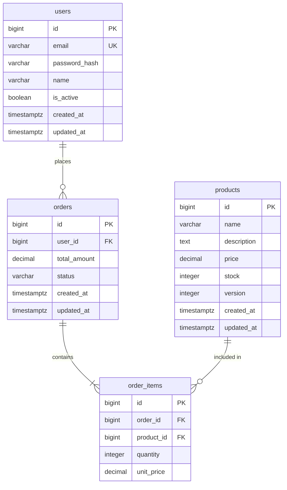

# Database Design

## 1. Relational vs NoSQL — Kapan Menggunakan Yang Mana?

| Kriteria | Relational (PostgreSQL, MySQL) | NoSQL (MongoDB, DynamoDB) |
|---|---|---|
| **Struktur data** | Terstruktur, relasi jelas antar-tabel | Semi-structured, schema bervariasi |
| **Konsistensi** | ACID transactions | Eventual consistency (umumnya) |
| **Query** | SQL — JOIN, aggregation, subquery | Document lookup, limited JOIN |
| **Scaling** | Vertical (read replicas untuk horizontal) | Horizontal native |
| **Contoh use case** | E-commerce, fintech, ERP, CRM | Content management, IoT, real-time analytics, session store |

**Aturan praktis:** Jika datamu punya relasi yang jelas (users → orders → order_items → products) dan butuh transaksi ACID, gunakan relational database. Pilih NoSQL hanya ketika ada alasan spesifik (schema sangat dinamis, skala sangat besar, key-value access pattern).

> Mayoritas aplikasi web cocok dengan relational database. Jangan pilih MongoDB hanya karena "lebih modern".

---

## 2. Normalisasi

Normalisasi menghilangkan redundansi data dan mencegah anomali saat insert/update/delete.

### First Normal Form (1NF)

**Aturan:** Setiap kolom berisi nilai atomik (tidak ada array atau nested data dalam satu kolom).

```
❌ Melanggar 1NF:
| id | nama  | telepon              |
|----|-------|----------------------|
| 1  | Budi  | 081234, 089876       |  ← dua nilai dalam satu kolom

✅ Memenuhi 1NF:
| id | nama  | telepon |
|----|-------|---------|
| 1  | Budi  | 081234  |
| 1  | Budi  | 089876  |

Atau lebih baik, buat tabel terpisah `user_phones`.
```

### Second Normal Form (2NF)

**Aturan:** Memenuhi 1NF + setiap kolom non-key bergantung pada **seluruh** primary key (relevan untuk composite key).

```
❌ Melanggar 2NF (composite key: order_id + product_id):
| order_id | product_id | product_name | quantity |
|----------|------------|--------------|----------|
product_name bergantung hanya pada product_id, bukan seluruh composite key.

✅ Memenuhi 2NF: pisahkan product_name ke tabel products.
```

### Third Normal Form (3NF)

**Aturan:** Memenuhi 2NF + tidak ada kolom non-key yang bergantung pada kolom non-key lain (transitive dependency).

```
❌ Melanggar 3NF:
| id | city     | zip_code | state    |
|----|----------|----------|----------|
state bisa ditentukan dari zip_code (transitive dependency).

✅ Memenuhi 3NF: pisahkan zip_code → state ke tabel terpisah.
```

### Kapan Denormalisasi?

Denormalisasi = sengaja menambah redundansi untuk **performa baca**.

**Boleh denormalisasi ketika:**
- Query tertentu terbukti lambat (sudah di-profile, bukan asumsi)
- Data yang di-denormalisasi jarang berubah
- Menghindari JOIN yang kompleks pada tabel besar

**Contoh:** Menyimpan `total_amount` di tabel `orders` selain menghitungnya dari `order_items`. Lebih cepat dibaca, tapi harus dijaga konsistensinya saat item berubah.

---

## 3. Primary Keys

### Auto-Increment (BIGINT/SERIAL)

```sql
id BIGSERIAL PRIMARY KEY
```

| Kelebihan | Kelemahan |
|---|---|
| Ukuran kecil (8 bytes), index efficient | ID bisa ditebak (enumeration attack) |
| Berurutan, baik untuk B-tree index | Tidak unik secara global (antar-database) |
| Human-readable | Konflik saat merge data dari multiple sources |

### UUID

```sql
id UUID PRIMARY KEY DEFAULT gen_random_uuid()
```

| Kelebihan | Kelemahan |
|---|---|
| Unik secara global | Ukuran besar (16 bytes), index kurang efficient |
| Tidak bisa ditebak (security) | Tidak berurutan → index fragmentation (kecuali UUIDv7) |
| Bisa di-generate di client tanpa hit DB | Tidak human-readable |

### Rekomendasi

- **UUIDv7** (time-ordered UUID): kombinasi terbaik — unik secara global, berurutan (baik untuk index), tidak bisa ditebak. Gunakan ini jika database mendukung.
- **BIGSERIAL**: untuk tabel internal yang tidak perlu exposed ke public API.
- **Jangan** gunakan UUID sebagai primary key tanpa index yang tepat.

---

## 4. Foreign Keys dan Referential Integrity

**Selalu** definisikan foreign key constraints di database.

```sql
CREATE TABLE orders (
    id BIGSERIAL PRIMARY KEY,
    user_id BIGINT NOT NULL REFERENCES users(id),
    created_at TIMESTAMPTZ NOT NULL DEFAULT NOW()
);
```

Foreign key menjamin:
- Tidak bisa insert order dengan `user_id` yang tidak ada di tabel `users`
- Tidak bisa delete user yang masih punya order (tanpa cascade)

### ON DELETE Options

| Option | Behavior | Kapan Digunakan |
|---|---|---|
| `RESTRICT` (default) | Tolak delete jika masih ada referensi | Umumnya paling aman |
| `CASCADE` | Hapus semua data terkait | Parent-child yang tightly coupled (order → order_items) |
| `SET NULL` | Set FK ke NULL | Optional relationship |
| `SET DEFAULT` | Set FK ke default value | Jarang digunakan |

---

## 5. Indexing Strategy

### B-tree Index (Default)

Index default di PostgreSQL. Cocok untuk operasi `=`, `<`, `>`, `<=`, `>=`, `BETWEEN`, `ORDER BY`.

### Kapan Menambah Index

**Tambah index pada:**
- Kolom di `WHERE` clause yang sering digunakan
- Kolom `JOIN` (foreign keys)
- Kolom `ORDER BY` pada query yang sering dijalankan

**Jangan** index kolom yang:
- Jarang di-query
- Memiliki cardinality sangat rendah (misal: kolom `boolean` dengan 50/50 distribusi)
- Berada di tabel dengan sangat banyak operasi `INSERT/UPDATE` (setiap index memperlambat write)

### Composite Index

Index pada beberapa kolom sekaligus. Urutan kolom penting.

```sql
-- Index ini efektif untuk:
-- WHERE status = 'active' AND created_at > '2024-01-01'
-- WHERE status = 'active'
-- TAPI TIDAK efektif untuk:
-- WHERE created_at > '2024-01-01' (tanpa status)
CREATE INDEX idx_orders_status_created ON orders(status, created_at);
```

**Aturan:** Kolom yang paling sering di-filter dengan `=` taruh di awal. Kolom range (`>`, `<`, `BETWEEN`) taruh di akhir.

### Covering Index

Index yang menyertakan semua kolom yang dibutuhkan query, sehingga database tidak perlu membaca tabel (index-only scan).

```sql
-- Query: SELECT email, name FROM users WHERE status = 'active'
CREATE INDEX idx_users_status_covering ON users(status) INCLUDE (email, name);
```

---

## 6. Common Data Patterns

### Soft Delete

Menandai record sebagai "dihapus" tanpa benar-benar menghapus dari database.

```sql
ALTER TABLE users ADD COLUMN deleted_at TIMESTAMPTZ DEFAULT NULL;

-- "Hapus" user
UPDATE users SET deleted_at = NOW() WHERE id = 123;

-- Query hanya user aktif
SELECT * FROM users WHERE deleted_at IS NULL;
```

**Kelebihan:** Data bisa di-restore, audit trail lengkap.
**Kelemahan:** Semua query harus menambah `WHERE deleted_at IS NULL`. Gunakan database view atau ORM default scope untuk membantu.

### Audit Trail / Timestamps

Setiap tabel transaksional **wajib** punya:

```sql
created_at TIMESTAMPTZ NOT NULL DEFAULT NOW(),
updated_at TIMESTAMPTZ NOT NULL DEFAULT NOW()
```

Setup trigger untuk auto-update `updated_at`:

```sql
CREATE OR REPLACE FUNCTION update_updated_at()
RETURNS TRIGGER AS $$
BEGIN
    NEW.updated_at = NOW();
    RETURN NEW;
END;
$$ LANGUAGE plpgsql;

CREATE TRIGGER trg_users_updated_at
    BEFORE UPDATE ON users
    FOR EACH ROW EXECUTE FUNCTION update_updated_at();
```

### Versioning (Optimistic Locking)

Kolom `version` untuk mencegah lost update pada concurrent writes.

```sql
ALTER TABLE products ADD COLUMN version INTEGER NOT NULL DEFAULT 1;

-- Update dengan optimistic lock
UPDATE products
SET name = 'New Name', version = version + 1
WHERE id = 123 AND version = 5;
-- Jika 0 rows affected → conflict, retry atau tolak
```

---

## 7. Schema Migration Strategy

- Gunakan migration tool (Prisma Migrate, Flyway, Knex, golang-migrate)
- Setiap perubahan schema = satu migration file bernomor urut
- Migration harus **reversible** (punya up dan down)
- Jangan pernah edit migration yang sudah dijalankan di production
- Test migration di staging sebelum production

```
migrations/
├── 001_create_users.sql
├── 002_create_orders.sql
├── 003_add_phone_to_users.sql
└── 004_create_order_items.sql
```

---

## 8. Naming Conventions

| Elemen | Konvensi | Contoh |
|---|---|---|
| Nama tabel | `snake_case`, **plural** | `users`, `order_items` |
| Nama kolom | `snake_case` | `first_name`, `created_at` |
| Primary key | `id` | `id` |
| Foreign key | `{singular_table}_id` | `user_id`, `order_id` |
| Index | `idx_{table}_{columns}` | `idx_orders_user_id` |
| Unique constraint | `uq_{table}_{columns}` | `uq_users_email` |
| Boolean column | Prefix `is_` atau `has_` | `is_active`, `has_verified` |
| Timestamp column | Suffix `_at` | `created_at`, `deleted_at` |

---

## 9. ER Diagram Contoh



---

## 10. Kesalahan Umum

### ❌ Tidak Ada Index pada Foreign Key
Foreign key constraint **tidak** otomatis membuat index (di PostgreSQL). Tanpa index, JOIN dan cascading delete sangat lambat.

```sql
-- Selalu buat index pada FK column
CREATE INDEX idx_orders_user_id ON orders(user_id);
```

### ❌ Over-Normalization
Memecah data ke terlalu banyak tabel sehingga query sederhana butuh 5+ JOIN. Normalisasi itu guideline, bukan dogma.

### ❌ Missing Timestamps
Tabel tanpa `created_at` dan `updated_at`. Debugging masalah data tanpa timestamp sangat menyulitkan.

### ❌ Menyimpan Harga di Satu Tempat
Hanya menyimpan `product_id` di `order_items` tanpa `unit_price`. Ketika harga produk berubah, histori order berubah juga.

**Solusi:** Simpan `unit_price` saat order dibuat (snapshot harga).

### ❌ Menggunakan VARCHAR untuk Semua Data
Tanggal disimpan sebagai string, angka disimpan sebagai string. Gunakan tipe data yang tepat — database bisa memvalidasi dan mengoptimasi query.

### ❌ Tidak Ada Constraint
Mengandalkan validasi hanya di application layer. Database constraint adalah safety net terakhir.

```sql
-- Gunakan CHECK constraint
ALTER TABLE products ADD CONSTRAINT chk_price_positive CHECK (price > 0);
ALTER TABLE order_items ADD CONSTRAINT chk_qty_positive CHECK (quantity > 0);
```

---

## 11. Dokumen Terkait

- [Data Dictionary](./data-dictionary.md) — dokumentasi detail setiap kolom
- [System Architecture](./system-architecture.md) — konteks arsitektur keseluruhan
- [API Design](./api-design.md) — bagaimana data diekspos via API
- [Architecture Decision Records](./architecture-decision-records.md) — ADR untuk keputusan database
