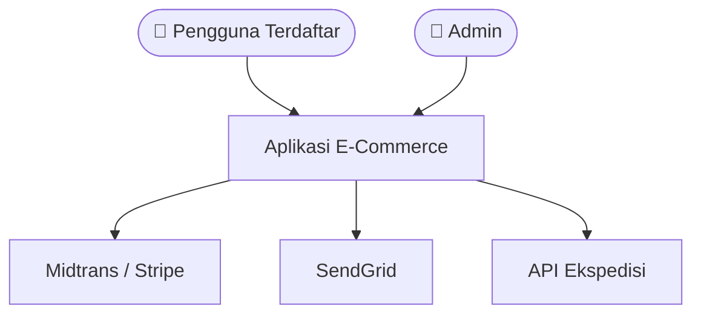
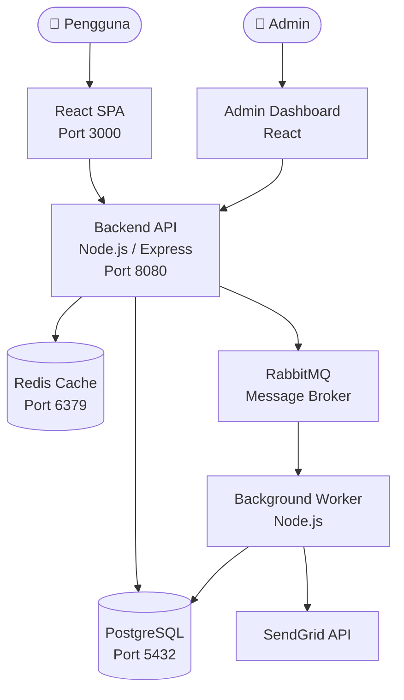

# System Architecture

## 1. Apa Itu Dokumen System Architecture?

Dokumen system architecture menjelaskan **struktur high-level** dari sistem perangkat lunak: komponen apa saja yang ada, bagaimana mereka berkomunikasi, dan teknologi apa yang digunakan. Dokumen ini menjadi **peta utama** bagi seluruh tim untuk memahami sistem tanpa harus membaca semua source code.

**Tujuan utama:**
- Memberikan gambaran besar sistem kepada developer baru dalam hitungan menit
- Menjadi referensi saat membuat keputusan teknis
- Mengomunikasikan desain ke stakeholder non-teknis

> 📄 Template: [System Architecture Template](../templates/design/system-architecture-template.md)

---

## 2. C4 Model — 4 Level Abstraksi

C4 Model (diciptakan oleh Simon Brown) membagi dokumentasi arsitektur menjadi 4 level zoom. Analoginya seperti Google Maps: kamu bisa zoom out melihat seluruh kota, atau zoom in ke satu gedung.

### Level 1 — System Context Diagram

**Apa:** Gambaran paling high-level. Menunjukkan sistem kamu sebagai satu kotak, lalu siapa yang menggunakannya dan sistem eksternal apa yang terhubung.

**Kapan digunakan:** Selalu. Setiap proyek wajib punya minimal diagram ini.

**Audience:** Semua orang — developer, product manager, stakeholder bisnis.



**Tips:** Jangan masukkan detail internal. Sistem kamu cukup satu kotak saja.

### Level 2 — Container Diagram

**Apa:** Zoom in ke dalam sistem. Menunjukkan container — yaitu unit yang bisa di-deploy secara terpisah: frontend app, backend API, database, message broker, dll.

**Kapan digunakan:** Hampir selalu. Wajib untuk proyek yang punya lebih dari satu container.

**Audience:** Tim teknis.



### Level 3 — Component Diagram

**Apa:** Zoom in ke dalam satu container. Menunjukkan komponen internal seperti controller, service, repository.

**Kapan digunakan:** Hanya untuk container yang kompleks dan perlu penjelasan internal.

**Audience:** Developer yang mengerjakan container tersebut.

### Level 4 — Code Diagram

**Apa:** Diagram class atau module-level detail.

**Kapan digunakan:** Jarang. Hanya untuk algoritma atau alur yang sangat kompleks. Kode berubah terlalu cepat — diagram ini cepat outdated.

> **Aturan praktis:** Sebagian besar proyek cukup Level 1 + Level 2. Tambahkan Level 3 hanya jika container-nya kompleks. Hindari Level 4 kecuali benar-benar perlu.

---

## 3. Dokumentasi Technology Stack

Dokumentasikan stack teknologi dalam format tabel agar mudah di-scan:

| Layer | Teknologi | Versi | Alasan Pemilihan |
|---|---|---|---|
| Frontend | React + TypeScript | 18.x | Ekosistem besar, tim sudah familiar |
| Backend | Node.js + Express | 20 LTS | JavaScript full-stack, non-blocking I/O |
| Database | PostgreSQL | 16.x | ACID compliance, JSON support, open source |
| Cache | Redis | 7.x | In-memory, pub/sub support |
| Message Broker | RabbitMQ | 3.x | Reliable message delivery, dead letter queue |
| Deployment | Docker + Docker Compose | - | Konsistensi environment dev/staging/prod |

---

## 4. Architecture Principles

Prinsip arsitektur adalah **aturan dasar** yang memandu semua keputusan desain.

### Separation of Concerns (SoC)

Setiap bagian sistem punya satu tanggung jawab yang jelas. Frontend menangani UI, backend menangani business logic, database menangani persistence.

```
❌  API endpoint yang langsung query database + format HTML + kirim email
✅  Controller → Service → Repository → Database (masing-masing layer punya tugas sendiri)
```

### Single Responsibility

Satu module/service menangani satu domain bisnis. Service `OrderService` tidak boleh mengurus logic pembayaran — itu tugas `PaymentService`.

### Stateless Services

Backend API tidak menyimpan state user di memory server. Semua state disimpan di database atau cache (Redis). Ini memungkinkan horizontal scaling — tinggal tambah instance server.

```
❌  let loggedInUsers = {} // state di memory server
✅  Session disimpan di Redis, JWT di client
```

---

## 5. Communication Patterns

### Synchronous (Request-Response)

| Protocol | Kapan Digunakan | Contoh |
|---|---|---|
| REST (HTTP/JSON) | Mayoritas API, CRUD operations | Frontend → Backend API |
| gRPC | Komunikasi antar-service yang butuh performa tinggi | Service internal microservices |

**Karakteristik:** Caller menunggu response. Sederhana, tapi bisa jadi bottleneck kalau downstream service lambat.

### Asynchronous (Message-Based)

| Mekanisme | Kapan Digunakan | Contoh |
|---|---|---|
| Message Queue (RabbitMQ) | Task yang bisa diproses nanti, guaranteed delivery | Kirim email, generate report |
| Event Streaming (Kafka) | Event log, real-time analytics, high throughput | Activity log, audit trail |

**Karakteristik:** Caller tidak menunggu. Lebih resilient, tapi lebih kompleks (eventual consistency, dead letter handling).

```
Contoh alur async:
User checkout → API simpan order ke DB → Publish event "OrderCreated" ke queue
→ Worker proses pembayaran → Worker kirim email konfirmasi
```

---

## 6. Dampak Non-Functional Requirements (NFR) pada Arsitektur

NFR bukan afterthought — mereka **membentuk** arsitektur.

| NFR | Dampak pada Arsitektur |
|---|---|
| **High Availability** | Multi-instance deployment, load balancer, health checks |
| **Scalability** | Stateless services, horizontal scaling, caching layer |
| **Low Latency** | CDN untuk static assets, Redis cache, database indexing |
| **Data Consistency** | ACID transactions, synchronous communication |
| **Auditability** | Event sourcing atau audit log table, immutable records |
| **Security** | API gateway, rate limiting, encryption at rest dan in transit |

---

## 7. Kesalahan Umum

### ❌ Big Design Up Front (BDUF)
Menghabiskan berminggu-minggu mendesain arsitektur sebelum menulis kode. Arsitektur harus **evolve** seiring pemahaman domain bertambah.

**Solusi:** Mulai dengan arsitektur sederhana (monolith), buat ADR untuk setiap keputusan, refactor saat kebutuhan muncul.

### ❌ Tidak Ada Diagram Sama Sekali
Tim mengandalkan "pengetahuan tribal" — hanya developer senior yang tahu bagaimana sistem bekerja.

**Solusi:** Minimal buat C4 Level 1 + Level 2. Taruh di README atau folder `/docs`.

### ❌ Terlalu Detail
Diagram yang menunjukkan setiap class dan method. Cepat outdated, tidak ada yang mau maintain.

**Solusi:** Fokus pada Level 1 dan 2. Update diagram hanya saat ada perubahan arsitektural signifikan, bukan setiap code change.

### ❌ Diagram Tanpa Penjelasan
Diagram Mermaid tanpa teks yang menjelaskan *mengapa* arsitektur dipilih demikian.

**Solusi:** Setiap diagram harus disertai paragraf penjelasan konteks dan keputusan.

---

## 8. Checklist Dokumen System Architecture

- [ ] C4 Level 1 (System Context) diagram ada
- [ ] C4 Level 2 (Container) diagram ada
- [ ] Technology stack terdokumentasi dengan alasan pemilihan
- [ ] Communication patterns (sync/async) dijelaskan
- [ ] NFR dan dampaknya terhadap arsitektur dicatat
- [ ] Diagram menggunakan format yang bisa di-version-control (Mermaid, PlantUML)

---

## 9. Dokumen Terkait

- [Architecture Patterns](./architecture-patterns.md) — pola arsitektur yang tersedia
- [Architecture Decision Records](./architecture-decision-records.md) — cara mendokumentasikan keputusan
- [Database Design](./database-design.md) — panduan perancangan database
- [API Design](./api-design.md) — panduan desain API
- **Template:** [System Architecture Template](../templates/design/system-architecture-template.md)
