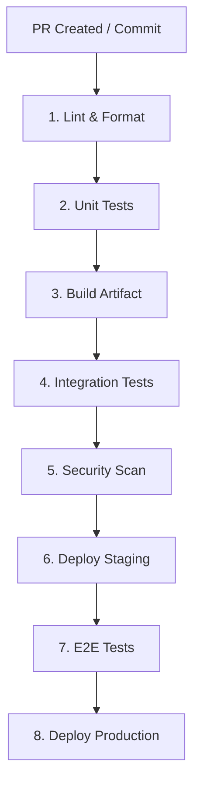

# Continuous Integration and Continuous Delivery (CI/CD)

Panduan arsitektur otomatisasi pipeline pengujian, pembuatan artefak (*build*), dan rilis produksi untuk tim rekayasa perangkat lunak modern.

---

## 1. Prinsip Dasar CI/CD

Otomatisasi pengiriman software meminimalkan galat manusia (*human error*), mempercepat siklus umpan balik, dan menjaga kestabilan kode di branch utama (`main`).

- **Continuous Integration (CI):** Praktik menggabungkan kode developer secara reguler ke *trunk/main* disertai verifikasi otomatis (lint, type check, unit test, build) pada setiap *Pull Request* (PR).
- **Continuous Delivery (CD):** Setiap perubahan yang lolos pipeline otomatis siap dirilis ke produksi sewaktu-waktu, namun tombol deployment produksi dipicu secara manual (*manual approval gate*).
- **Continuous Deployment:** Setiap commit yang lolos seluruh tahapan pengujian langsung meluncur ke produksi secara otomatis tanpa intervensi manual sama sekali.

```
+-------------------------------------------------------------+
| Continuous Integration (CI)                                 |
| Code -> Lint -> Unit Test -> Build Artifact                 |
+-------------------------------------------------------------+
                              |
+-----------------------------v-------------------------------+
| Continuous Delivery (CD)                                    |
| Deploy Staging -> E2E Tests -> [Manual Gate] -> Deploy Prod |
+-------------------------------------------------------------+
                              |
+-----------------------------v-------------------------------+
| Continuous Deployment (Full Auto)                           |
| Deploy Staging -> E2E Tests -> Auto Deploy Production       |
+-------------------------------------------------------------+
```

---

## 2. Arsitektur dan Tahapan Pipeline Standar

Setiap *commit* atau PR harus melalui alur bertahap dari biaya komputasi termurah hingga termahal:



### Rincian Tahapan Pipeline:
1. **Lint & Format:** Pemeriksaan sintaks, gaya kode (ESLint, Prettier, Ruff, golangci-lint), dan type-check (`tsc --noEmit`). Waktu: `< 1 menit`.
2. **Unit Tests:** Menguji logika bisnis terkecil tanpa dependensi I/O lambat. Waktu: `< 2 menit`.
3. **Build Artifact:** Mengompilasi binary atau mem-package Docker image dengan tag SHA commit spesifik. Waktu: `< 3 menit`.
4. **Integration Tests:** Menjalankan pengujian antar modul dengan database ephemeral (Docker/Service container). Waktu: `< 3 menit`.
5. **Security Scan:** SAST (Static Application Security Testing) dan vulnerability scan pada dependencies (`npm audit`, Trivy, Snyk).
6. **Deploy Staging:** Merilis artefak yang sama ke environment staging untuk verifikasi akhir.
7. **E2E Tests:** Pengujian alur kritis (Playwright, Cypress) pada environment staging.
8. **Deploy Production:** Rilis ke pengguna riil via strategi zero-downtime (Rolling atau Blue-Green).

---

## 3. Prinsip Emas: Build Once, Deploy Anywhere

**Jangan pernah melakukan re-build kode per environment.**

Jika Anda menjalankan `npm run build` sekali lagi untuk staging dan sekali lagi untuk production, Anda berisiko merilis artefak yang berbeda karena versi transitive dependencies atau build flag yang berbeda.

- **Immutable Artifacts:** Buat satu image Docker atau tarball biner di tahap CI:
  `my-app:git-sha-7a1b2c3`
- Artefak ini diuji di staging.
- Setelah diverifikasi lolos, image biner yang identik dipromosikan ke production.
- Variasi konfigurasi antar lingkungan (URL database, API key, log level) disuntikkan murni melalui **Environment Variables** saat runtime.

---

## 4. Kecepatan Umpan Balik (Fast Feedback Loops)

Target durasi total pipeline CI untuk setiap PR adalah **di bawah 10 menit**. Pipeline yang lambat memicu developer melewati tes atau beralih fokus (*context switching*).

### Strategi Akselerasi Pipeline:
- **Fail Fast:** Jalankan linting dan unit test di awal secara paralel. Jika lint gagal, batalkan seluruh job berikutnya segera.
- **Matrix / Parallel Jobs:** Pisahkan test suite menjadi beberapa shard yang berjalan bersamaan di runner berbeda.
- **Smart Test Runner:** Gunakan tool yang hanya menjalankan tes pada file yang terdampak oleh diff PR (misal: Jest `--changedSince`, Turborepo, Nx).

---

## 5. Strategi Caching Efektif

Mengunduh dependensi (node_modules, Go modules, Maven packages) pada setiap job memboroskan bandwidth dan waktu.

- **Dependency Cache:** Cache folder package manager berdasarkan hash lockfile (`package-lock.json`, `go.sum`, `Cargo.lock`).
- **Docker Layer Cache:** Manfaatkan BuildKit (`--cache-from`, `type=gha`) agar step `COPY . .` tidak membatalkan layer `RUN npm install`.
- **Compiler / Test Cache:** Gunakan ccache, Next.js `.next/cache`, atau Turborepo remote cache untuk menghindari kompilasi ulang kode yang tidak berubah.

```yaml
# Contoh Caching di GitHub Actions
- name: Cache Node Modules
  uses: actions/cache@v4
  with:
    path: ~/.npm
    key: ${{ runner.os }}-node-${{ hashFiles('**/package-lock.json') }}
    restore-keys: |
      ${{ runner.os }}-node-
```

---

## 6. Perbandingan Tool CI/CD Populer

| Fitur | GitHub Actions | GitLab CI |
|---|---|---|
| **Integrasi Ekosistem** | Terhubung langsung dengan GitHub PR & Releases | Sangat kuat dengan repositori GitLab terpadu |
| **Konfigurasi** | YAML di `.github/workflows/` | Single YAML file `.gitlab-ci.yml` |
| **Marketplace Actions** | Ribuan actions siap pakai dari komunitas | Komponen CI/CD dan template Docker resmi |
| **Self-Hosted Runner** | Didukung (mudah disetup di VM/K8s) | Didukung (GitLab Runner sangat fleksibel) |
| **Rekomendasi Tim Kecil** | Pilihan terbaik jika kode di GitHub | Pilihan terbaik jika menggunakan self-hosted GitLab |

---

## 7. Kesalahan Umum (Common Mistakes)

1. **Rebuild Image untuk Setiap Tier:** Membuat image terpisah untuk dev, staging, dan prod. Menghancurkan jaminan bahwa apa yang diuji di staging adalah apa yang berjalan di prod.
2. **Secrets Disimpan di Git Repository:** Menyimpan private key atau password database di dalam file workflow alih-alih encrypted GitHub Secrets / GitLab CI Variables.
3. **Flaky Tests Dibiarkan:** Mengabaikan tes yang kadang lulus kadang gagal (*intermittent failure*). Mengikis kepercayaan tim terhadap status hijau CI.
4. **Pipeline Monolitik Tanpa Paralelisasi:** Menjalankan lint, backend test, frontend test, dan security scan secara sekuensial hingga memakan waktu > 30 menit.
5. **Mengabaikan Branch Protection:** Mengizinkan developer melakukan `git push` langsung ke branch `main` tanpa kewajiban melewati checks CI.

---

## 8. Dokumen Terkait

- [Environment Strategy](environment-strategy.md)
- [Deployment Guide](deployment-guide.md)
- [Release Management](release-management.md)
- [Release Readiness Checklist](release-readiness.md)
- [Monitoring and Observability](monitoring-and-observability.md)
