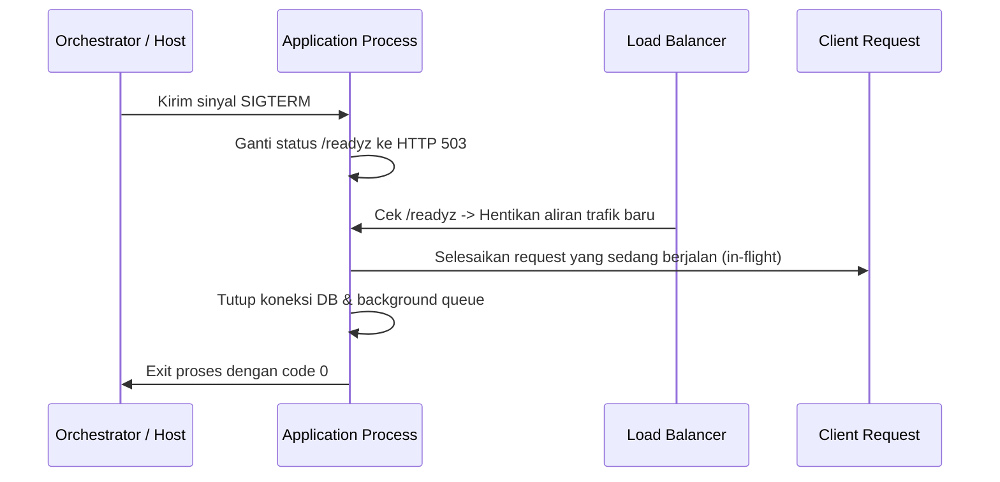

# Deployment Guide

Panduan komprehensif pemilihan strategi deployment, implementasi zero-downtime, penanganan health probes, dan koordinasi migrasi database bagi software engineer.

Template acuan: [Deployment Guide Template](../templates/delivery/deployment-guide-template.md)

---

## 1. Perbandingan Strategi Deployment

Memilih strategi deployment bergantung pada toleransi downtime aplikasi, anggaran infrastruktur, dan kompleksitas sistem.

| Strategi | Deskripsi | Zero Downtime? | Kebutuhan Resource | Kompleksitas Rollback | Kelebihan | Kekurangan |
|---|---|---|---|---|---|---|
| **Recreate** | Matikan semua instans lama, lalu jalankan instans baru | ❌ Tidak (ada jendela downtime) | Paling rendah (1x kapasitas) | Rendah (re-deploy versi lama) | Sederhana, tidak ada konflik kompatibilitas versi | Terjadi downtime saat transisi |
| **Rolling Update** | Ganti pod/instans lama secara bertahap satu per satu | ✅ Ya | Sedang (1x + buffer kecil, misal 25%) | Sedang (rolling update mundur) | Hemat biaya, transisi mulus | Dua versi kode aktif bersamaan untuk sementara |
| **Blue-Green** | Siapkan armada baru (Green) berdampingan dengan armada aktif (Blue), lalu alihkan trafik router | ✅ Ya | Tinggi (2x kapasitas selama proses) | Sangat Cepat & Mudah (alihkan router kembali ke Blue) | Uji coba instans baru sebelum live, rollback instan | Biaya ganda, perlu perhatian khusus koneksi database |
| **Canary** | Rilis ke sebagian kecil trafik (misal 5%), pantau error, lalu bertahap naikkan ke 100% | ✅ Ya | Sedang ke Tinggi | Cepat (hentikan rilis canary) | Deteksi kegagalan dengan dampak pengguna minimal | Perlu routing pintar (service mesh / router) dan monitoring matang |

---

## 2. Persyaratan Zero-Downtime Deployment

Untuk mencapai zero-downtime (tidak ada request yang terputus atau mendapat respons 502/503), sistem harus memenuhi empat pilar:

1. **Multiple Instances:** Minimal 2 replika aplikasi berjalan di belakang Load Balancer / Reverse Proxy.
2. **Backward-Compatible API & Data:** Versi kode baru `v2` dan versi `v1` harus dapat membaca skema database yang sama.
3. **Graceful Shutdown:** Aplikasi harus menolak request baru saat menerima sinyal `SIGTERM`, namun menyelesaikan request yang sedang berjalan dalam batas tenggat waktu (*grace period*).
4. **Health Probes yang Tepat:** Load balancer hanya boleh mengalirkan trafik setelah container benar-benar siap melayani request.

---

## 3. Graceful Shutdown dan Health Probes

### Perbedaan Liveness vs Readiness Probes

Dalam orkestrator seperti Kubernetes atau ECS:
- **Liveness Probe (`/healthz`):** Memeriksa apakah proses aplikasi masih hidup atau mengalami *deadlock*. Jika gagal berulang kali, orchestrator akan me-restart container.
- **Readiness Probe (`/readyz`):** Memeriksa apakah aplikasi sudah siap menerima trafik masuk (koneksi database telah terbentuk, file cache telah di-load). Jika gagal, orchestrator akan mencabut container dari daftar target load balancer tanpa mematikan prosesnya.



### Contoh Kode Graceful Shutdown (Node.js Express):

```javascript
const server = app.listen(port, () => console.log(`Listening on ${port}`));

process.on('SIGTERM', () => {
  console.log('SIGTERM received: closing HTTP server...');
  // 1. Berhenti menerima koneksi baru
  server.close(async () => {
    console.log('HTTP server closed. Closing DB connections...');
    // 2. Tutup koneksi dependensi
    await db.disconnect();
    process.exit(0);
  });

  // 3. Batas waktu paksa (force kill) jika request macet
  setTimeout(() => {
    console.error('Forced shutdown due to timeout');
    process.exit(1);
  }, 10000); // 10 detik grace period
});
```

---

## 4. Koordinasi Migrasi Database dengan Deployment

Salah satu penyebab downtime terbesar adalah migrasi skema database yang mengunci tabel (*table lock*) atau memutus kompatibilitas aplikasi lama.

**Urutan Eksekusi yang Benar:**
1. **Pre-Deployment:** Jalankan migrasi database yang bersifat *additive* (tambah kolom baru nullable, buat index secara concurrently).
2. **Deployment:** Rilis kode aplikasi baru yang mulai menulis ke kolom baru tanpa menghapus ketergantungan pada kolom lama.
3. **Post-Deployment:** Setelah versi baru stabil 100% di produksi, jalankan script cleanup atau contract migration pada rilis berikutnya.

---

## 5. Prosedur Deployment: Manual vs Otomatis

### Manual Deployment Checklist (Hanya untuk Tim Awal / Darurat)
- [ ] Verifikasi backup database terbaru telah selesai dan valid.
- [ ] Beri notifikasi di channel internal (`#ops-deploy`).
- [ ] Tarik image Docker resmi via commit hash yang telah diuji di Staging.
- [ ] Jalankan pre-migration skema database.
- [ ] Terapkan rolling update atau switch load balancer.
- [ ] Lakukan smoke test pada endpoint kritis (`/healthz`, `/api/login`).
- [ ] Pantau dashboard metrics selama 15 menit pasca rilis.

### Automated Continuous Deployment (Rekomendasi Utama)
- Deployment dipicu oleh tag Git atau merge ke `main` via CI/CD runner.
- Validasi otomatis: jika smoke test atau health check gagal dalam 2 menit, runner otomatis melakukan rollback ke image sebelumnya.
- Notifikasi terkirim otomatis ke Slack/Discord/Telegram tim dengan ringkasan status rilis.

---

## 6. Kesalahan Umum (Common Mistakes)

1. **Liveness Probe Memeriksa Database:** Menghubungkan `/healthz` langsung dengan query database. Ketika database lambat sejenak, seluruh armada pod akan di-restart massal dan memperparah crash (*cascading failure*).
2. **Tidak Mengatur Grace Period:** Mematikan container secara instan (`SIGKILL`) sehingga request pengguna yang sedang bertransaksi terputus di tengah jalan.
3. **Rollback Bergantung pada Rebuild Kode:** Ketika terjadi insiden di prod, tim mencoba memperbaiki bug dan build ulang alih-alih me-rollback instan ke image container lama yang sudah terbukti stabil.
4. **Mengubah Skema DB dan Kode Aplikasi Sekaligus:** Mengubah nama kolom di database bersamaan dengan deploy kode, merusak instans lama yang masih menerima request.
5. **Deploy di Luar Jam Kerja Tanpa On-Call:** Melakukan rilis pada Jumat sore atau larut malam tanpa personil yang siap siaga menangani insiden.

---

## 7. Dokumen Terkait

- [Deployment Guide Template](../templates/delivery/deployment-guide-template.md)
- [Environment Strategy](environment-strategy.md)
- [CI/CD Pipelines](ci-cd.md)
- [Release Management](release-management.md)
- [Database Migration and Rollback](database-migration-and-rollback.md)
- [Monitoring and Observability](monitoring-and-observability.md)
