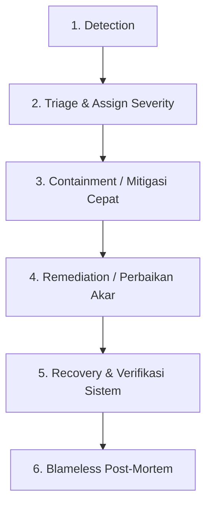

# Incident Response Guide

Panduan manajemen insiden operasional, matriks tingkat keparahan (*severity levels*), peran tim tanggap darurat, alur kerja penanganan, dan penyusunan *blameless post-mortem*.

Template acuan: [Operations Runbook Template](../templates/delivery/operations-runbook-template.md)

---

## 1. Matriks Tingkat Keparahan (Severity Matrix)

Standarisasi klasifikasi insiden mencegah kepanikan dan memastikan respons dialokasikan secara proporsional.

| Severity | Definisi Dampak | Contoh Kasus | Respon SLA (ACK) | Target Mitigasi | Pembaruan Komunikasi |
|---|---|---|---|---|---|
| **SEV-1 (Kritis)** | Layanan inti mati total untuk mayoritas pengguna; dampak finansial/reputasi langsung | Database prod crash, sistem login lumpuh, gateway pembayaran mati | `< 15 menit` | `< 1 jam` | Setiap 15–30 menit |
| **SEV-2 (Mayor)** | Fitur utama terdegradasi parah; tidak ada workaround praktis bagi pengguna | Pengguna tidak bisa upload file verifikasi KYC, search engine error | `< 30 menit` | `< 4 jam` | Setiap 1 jam |
| **SEV-3 (Moderat)** | Fitur sekunder bermasalah; ada alternatif solusi sementara (*workaround*) | Ekspor laporan PDF gagal, email notifikasi invoice tertunda | `< 2 jam` | 1 hari kerja | Setiap 4 jam / saat resolve |
| **SEV-4 (Minor)** | Gangguan minor, kesalahan teks/kosmetik tanpa dampak transaksi bisnis | Typo pada halaman FAQ, alignment CSS tombol di dashboard admin | `< 8 jam` | Sesuai sprint backlog | Saat resolved |

---

## 2. Peran Tim Tanggap Darurat (Incident Roles)

Saat insiden SEV-1 atau SEV-2 terjadi, tim harus beroperasi dengan komando tunggal yang jelas:

- **Incident Commander (IC):**
  - Memegang otoritas penuh jalannya penanganan insiden.
  - Mengarahkan investigasi, mendelegasikan tugas, dan mengambil keputusan kritis (misal: rollback vs hotfix).
  - Tidak menulis kode atau mengeksekusi terminal secara langsung agar tetap memiliki gambaran makro.
- **Tech Lead / Investigation Lead:**
  - Memimpin penyelidikan teknis, membaca log, menganalisis trace, dan menguji perbaikan.
  - Memberikan rekomendasi teknis kepada IC.
- **Communications Lead:**
  - Bertanggung jawab memperbarui status page publik dan mengelola komunikasi ke stakeholder bisnis, tim CS, dan eksekutif.
  - Melindungi engineer teknis dari interupsi pertanyaan langsung dari luar ruangan penanganan.

---

## 3. Alur Kerja Penanganan Insiden (Incident Workflow)



### 1. Detection (Deteksi)
Insiden terdeteksi lewat alert automated monitoring (PagerDuty), laporan tim customer support, atau error spiking.

### 2. Triage & Mobilization
Menentukan severity (SEV-1 s/d SEV-4), menunjuk Incident Commander, dan membuka *Incident War Room* (ruang Google Meet / Slack khusus `#incident-20261025-auth`).

### 3. Containment (Pencegahan Dampak)
Fokus utama adalah **menghentikan pendarahan**, bukan mencari pelaku atau akar masalah terdalam:
- Matikan feature flag yang bermasalah.
- Lakukan rollback ke image deployment sebelumnya.
- Aktifkan rate limiter atau alihkan traffic via Cloudflare.

### 4. Remediation (Perbaikan Masalah)
Setelah dampak pengguna diredam, implementasikan perbaikan permanen (hotfix yang diuji di staging) atau konfigurasi ulang database.

### 5. Recovery & Verifikasi
Pantau metrik pilar RED selama minimal 30 menit. Konfirmasikan bahwa error rate kembali normal dan antrean request terproses.

### 6. Post-Mortem (Tinjauan Pasca-Insiden)
Lakukan evaluasi retrospektif tanpa mencari kambing hitam (*blameless*) dalam waktu 48 jam pasca insiden.

---

## 4. Templat Komunikasi Stakeholder & Status Page

Gunakan gaya bahasa faktual, transparan, dan tidak defensif.

### Format Pembaruan Status Page (SEV-1):
```text
[INVESTIGATING - 14:15 WIB]
Kami sedang menyelidiki laporan kendala yang menyebabkan sebagian pengguna gagal 
melakukan proses checkout. Tim teknis sedang menelusuri gateway pembayaran. 
Pembaruan berikutnya akan diberikan dalam waktu 30 menit.

[IDENTIFIED - 14:40 WIB]
Penyebab kendala telah diidentifikasi pada koneksi pihak ketiga penyedia gateway. 
Tim kami sedang menerapkan pengalihan rute pembayaran cadangan.

[MONITORING - 15:05 WIB]
Pengalihan rute cadangan telah selesai diimplementasikan. Transaksi checkout telah 
kembali normal dan kami terus memantau stabilitas sistem.

[RESOLVED - 15:35 WIB]
Seluruh layanan pembayaran telah beroperasi normal secara penuh. Laporan insiden 
lengkap akan dibagikan setelah investigasi selesai.
```

---

## 5. Proses Blameless Post-Mortem

Asumsi dasar *blameless*: **"Setiap engineer bertindak dengan niat baik berdasarkan informasi terbaik yang mereka miliki saat itu."** Jika sistem gagal karena kesalahan input manual, maka kegagalan terletak pada desain sistem yang mengizinkan kesalahan itu terjadi.

### Komponen Laporan Post-Mortem:
1. **Ringkasan Eksekutif:** Apa yang terjadi, durasi, dampak bisnis (misal: 1.200 transaksi tertunda).
2. **Linimasa Kejadian (Timeline Menit-demi-Menit):** Catatan waktu faktual sejak alarm pertama hingga status hijau.
3. **Analisis Akar Masalah (5 Whys Technique):** Menemukan celah mendasar pada arsitektur atau proses.
4. **Action Items (SMART):** Tugas perbaikan preventif yang memiliki pemilik tugas (*owner*) tunggal dan batas waktu penyelesaian (*deadline*).

```
Contoh Action Item yang Benar:
- [ ] Tambahkan circuit breaker pada HTTP client gateway pembayaran (Owner: Budi, Due: 30 Okt)
- [ ] Ubah connection pool database timeout dari 60s menjadi 5s (Owner: Siti, Due: 28 Okt)
```

---

## 6. Kesalahan Umum (Common Mistakes)

1. **Mencari Kambing Hitam (Blame Game):** Menyalahkan developer yang membuat commit error sehingga anggota tim takut melaporkan kegagalan sistem.
2. **Terlalu Sibuk Mencari Solusi Sempurna Saat Darurat:** Menghabiskan waktu 2 jam mencari penyebab bug alih-alih langsung melakukan rollback deployment dalam 2 menit.
3. **Meninggalkan Stakeholder dalam Kegelapan:** Tidak memberikan kabar sama sekali ke manajemen atau pengguna selama insiden berlangsung.
4. **Action Items Post-Mortem Tidak Pernah Dikerjakan:** Mengarsipkan dokumen post-mortem tanpa memasukkan daftar tiket perbaikan ke sprint backlog.
5. **Setiap Orang Bertindak Sendiri Tanpa Komando:** Beberapa engineer menjalankan perbaikan berbeda di server produksi secara simultan tanpa koordinasi dengan Incident Commander.

---

## 7. Dokumen Terkait

- [Operations Runbook Template](../templates/delivery/operations-runbook-template.md)
- [Monitoring and Observability](monitoring-and-observability.md)
- [Backup and Recovery](backup-and-recovery.md)
- [Deployment Guide](deployment-guide.md)
- [Release Readiness Checklist](release-readiness.md)
