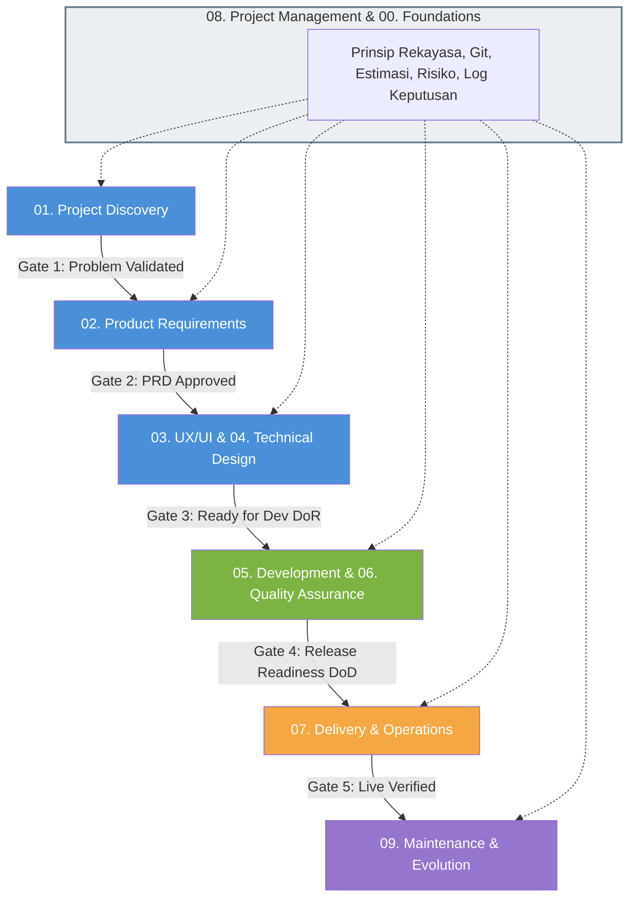

# Software Development Playbook 📘

Basis pengetahuan jangka panjang (*long-term knowledge base*), panduan kerja standar, dan kumpulan template siap pakai untuk memandu siklus hidup rekayasa perangkat lunak dari penemuan masalah (*discovery*) hingga pemeliharaan (*maintenance*).

Repositori ini bukan aplikasi perangkat lunak dan bukan tempat menulis kode produk. Repositori ini adalah **standar acuan operasional rekayasa perangkat lunak** yang dapat diterapkan berulang kali untuk berbagai skala proyek: mulai dari proyek mandiri (*solo developer*), aplikasi internal organisasi, REST API, hingga platform SaaS modern.

---

## 1. Sasaran Pembaca

- **Mahasiswa IT & Junior Developer**: Memahami bagaimana teori rekayasa perangkat lunak diterapkan secara nyata di industri tanpa jargon berlebihan.
- **Solo Developer**: Menjaga disiplin kerja terstruktur, mencegah ruang lingkup membengkak (*scope creep*), dan memastikan kode mudah dipelihara di masa depan.
- **Software Engineer & Tech Lead**: Menstandarisasi proses desain arsitektur, konvensi API, strategi pengujian, dan otomatisasi rilis.
- **Tim Kecil & Startup**: Baseline alur kerja terpadu antara Product, Design, Engineering, QA, dan DevOps tanpa birokrasi yang membebani.

---

## 2. Peta Siklus Hidup (SDLC) & Stage Gates

Playbook ini mengintegrasikan seluruh tahapan pengembangan melalui 5 Pintu Gerbang Kualitas (*Stage Gates*). Gate berfungsi sebagai titik evaluasi keputusan (Go, Hold, Kill, atau Pivot), bukan birokrasi penghambat.

### Ringkasan 5 Pintu Gerbang Kualitas:
1. **Gate 1 (Discovery Readiness)**: Memastikan masalah nyata terbukti ada, pengguna teridentifikasi, dan kelayakan teknis/biaya telah dievaluasi sebelum merancang solusi.
2. **Gate 2 (Requirements & PRD Approval)**: PRD, batasan ruang lingkup MVP, aturan bisnis, dan kriteria penerimaan telah disepakati oleh stakeholder.
3. **Gate 3 (Design Readiness / Ready for Dev)**: Desain arsitektur, skema database, kontrak API, spesifikasi UI, dan tiket kerja telah memenuhi *Definition of Ready (DoR)*.
4. **Gate 4 (Quality Verification & Release Readiness)**: Seluruh kode lulus review, pengujian otomatis hijau, bebas bug kritis, lulus UAT, dan memenuhi *Definition of Done (DoD)*.
5. **Gate 5 (Live Verification & Maintenance)**: Aplikasi live di production, observabilitas aktif, rencana rollback siap, dan sistem masuk ke siklus pemeliharaan rutin.

---

## 3. Peta Struktur Repositori

| Direktori | Fokus & Deskripsi Materi | Dokumen Kunci |
|---|---|---|
| [`00-foundations/`](00-foundations/README.md) | Prinsip dasar rekayasa, siklus SDLC, alur kerja Git & GitHub, Diátaxis docs, dan glosarium istilah. | [SDLC](00-foundations/software-development-lifecycle.md), [Principles](00-foundations/software-engineering-principles.md), [Git](00-foundations/git-and-github-workflow.md), [Glossary](00-foundations/glossary.md) |
| [`01-project-discovery/`](01-project-discovery/README.md) | Validasi masalah pengguna, analisis stakeholder (RACI), riset pengguna, asumsi & batasan, serta studi kelayakan. | [Problem Discovery](01-project-discovery/problem-discovery.md), [Feasibility](01-project-discovery/feasibility-analysis.md), [Exit Criteria](01-project-discovery/discovery-exit-criteria.md) |
| [`02-product-requirements/`](02-product-requirements/README.md) | Panduan penulisan PRD, kebutuhan fungsional (FR), user stories, use cases, business rules, prioritisasi (RICE/MoSCoW), dan RTM. | [PRD Guide](02-product-requirements/prd-guide.md), [User Stories](02-product-requirements/user-stories-and-use-cases.md), [Business Rules](02-product-requirements/business-rules.md) |
| [`03-ux-ui-design/`](03-ux-ui-design/README.md) | Arsitektur informasi, alur pengguna (*user flows*), wireframing, design tokens, design system, status UI & error messages, dan WCAG 2.1 AA. | [Information Architecture](03-ux-ui-design/information-architecture.md), [UI States](03-ux-ui-design/ui-states-and-error-messages.md), [Accessibility](03-ux-ui-design/accessibility-and-responsive-design.md) |
| [`04-technical-design/`](04-technical-design/README.md) | Arsitektur sistem C4, perbandingan pola monolit vs microservices, ADR, perancangan database relasional, kontrak REST API, RFC 7807, dan keamanan. | [System Architecture](04-technical-design/system-architecture.md), [ADR](04-technical-design/architecture-decision-records.md), [Database Design](04-technical-design/database-design.md), [API Design](04-technical-design/api-design.md) |
| [`05-development-practices/`](05-development-practices/README.md) | Struktur repositori, standar coding, panduan code review, alur branching & commits, konfigurasi 12-factor, dependensi, dan onboarding dev. | [Repository Structure](05-development-practices/repository-structure.md), [Coding Standards](05-development-practices/coding-standards.md), [Code Review](05-development-practices/code-review.md) |
| [`06-quality-assurance/`](06-quality-assurance/README.md) | Strategi piramida pengujian, unit test AAA, integration test, E2E, pengujian API, desain test case (BVA/EP), DoR, DoD, dan pelaporan bug. | [Test Strategy](06-quality-assurance/test-strategy.md), [Test Case Design](06-quality-assurance/test-case-design.md), [DoR](06-quality-assurance/definition-of-ready.md), [DoD](06-quality-assurance/definition-of-done.md) |
| [`07-delivery-operations/`](07-delivery-operations/README.md) | Strategi tier environment, pipeline CI/CD, deployment zero-downtime, SemVer, migrasi database expand-and-contract, backup 3-2-1, APM, dan respon insiden. | [CI/CD](07-delivery-operations/ci-cd.md), [Deployment Guide](07-delivery-operations/deployment-guide.md), [DB Migration](07-delivery-operations/database-migration-and-rollback.md), [Incident Response](07-delivery-operations/incident-response.md) |
| [`08-project-management/`](08-project-management/README.md) | Piagam proyek (*charter*), WBS roadmap, estimasi Planning Poker, register risiko 5x5, decision log, tata kelola perubahan, dan pelaporan RAG. | [Project Charter](08-project-management/project-charter.md), [Risk Register](08-project-management/risk-register.md), [Stage Gates](08-project-management/stage-gate-process.md) |
| [`09-maintenance-evolution/`](09-maintenance-evolution/README.md) | Manajemen technical debt (aturan 20%), pembaruan dependensi otomatis, review performa kuartalan, siklus depresiasi 5 tahap, dan retrospektif rilis. | [Technical Debt](09-maintenance-evolution/technical-debt.md), [Dependency Updates](09-maintenance-evolution/dependency-updates.md), [Post-Release Review](09-maintenance-evolution/post-release-review.md) |
| [`templates/`](templates/README.md) | 36 template dokumen operasional siap pakai yang mencakup seluruh fase SDLC dengan instruksi pengisian terpisah. | [Katalog Lengkap Template](templates/README.md) |
| [`examples/`](examples/README.md) | Dua studi kasus konkret end-to-end: Aplikasi Mobile FinTech (*DompetKu*) dan Situs Web Organisasi Nirlaba (*Yayasan Bina Karya*). | [Studi Kasus 1 (DompetKu)](examples/personal-finance-app/README.md), [Studi Kasus 2 (Yayasan)](examples/organization-website/README.md) |
| [`checklists/`](checklists/README.md) | 9 daftar periksa kesiapan fase untuk memverifikasi mutu sebelum melangkah ke tahap berikutnya. | [Daftar Lengkap Checklists](checklists/README.md) |
| [`resources/`](resources/README.md) | Standar internasional (ISO, OWASP, WCAG, RFC), buku rekomendasi industri, kursus terbuka, dan perangkat lunak bantu. | [Standar](resources/standards-and-frameworks.md), [Buku](resources/recommended-books.md), [Tools](resources/useful-tools.md) |

---

## 4. Panduan Jalur Belajar (Learning Paths)

Pilihlah jalur belajar sesuai peran atau kebutuhan Anda saat ini:

### 4.1 Jalur Mahasiswa & Junior Developer (Fondasi Lengkap)
1. Mulai dari [`00-foundations/software-development-lifecycle.md`](00-foundations/software-development-lifecycle.md) dan [`software-engineering-principles.md`](00-foundations/software-engineering-principles.md).
2. Pahami alur kolaborasi tim di [`00-foundations/git-and-github-workflow.md`](00-foundations/git-and-github-workflow.md).
3. Pelajari cara membaca dan menulis kebutuhan fitur di [`02-product-requirements/user-stories-and-use-cases.md`](02-product-requirements/user-stories-and-use-cases.md).
4. Pelajari standar penulisan kode di [`05-development-practices/coding-standards.md`](05-development-practices/coding-standards.md) dan pengujian di [`06-quality-assurance/unit-testing.md`](06-quality-assurance/unit-testing.md).
5. Pelajari contoh nyata implementasi di [`examples/personal-finance-app/`](examples/personal-finance-app/README.md).

### 4.2 Jalur Solo Developer / Indie Hacker (Eksekusi Cepat & Efisien)
1. Baca [`00-foundations/software-project-types.md`](00-foundations/software-project-types.md) untuk memilih pendekatan arsitektur yang proporsional.
2. Lakukan validasi masalah cepat dengan [`01-project-discovery/problem-discovery.md`](01-project-discovery/problem-discovery.md).
3. Buat PRD ringkas menggunakan [`templates/product/prd-template.md`](templates/product/prd-template.md).
4. Terapkan arsitektur modular monolit di [`04-technical-design/architecture-patterns.md`](04-technical-design/architecture-patterns.md) dan amankan rahasia via [`05-development-practices/environment-configuration.md`](05-development-practices/environment-configuration.md).
5. Otomatisasi deployment sejak hari pertama dengan [`07-delivery-operations/ci-cd.md`](07-delivery-operations/ci-cd.md).

### 4.3 Jalur Tech Lead & Engineering Manager (Standardisasi Tim)
1. Tetapkan kesepakatan tim pada [`06-quality-assurance/definition-of-ready.md`](06-quality-assurance/definition-of-ready.md) dan [`definition-of-done.md`](06-quality-assurance/definition-of-done.md).
2. Terapkan budaya pencatatan keputusan arsitektur via [`04-technical-design/architecture-decision-records.md`](04-technical-design/architecture-decision-records.md).
3. Terapkan standar code review di [`05-development-practices/code-review.md`](05-development-practices/code-review.md) dan [`checklists/code-review.md`](checklists/code-review.md).
4. Bangun manajemen risiko dan stage-gate di [`08-project-management/stage-gate-process.md`](08-project-management/stage-gate-process.md).
5. Kelola utang teknis secara rutin melalui [`09-maintenance-evolution/technical-debt.md`](09-maintenance-evolution/technical-debt.md).

---

## 5. Cara Menggunakan Template, Checklist, dan Contoh

### Menggunakan Template pada Proyek Baru:
1. Masuk ke direktori [`templates/`](templates/README.md).
2. Salin berkas template yang relevan ke dalam folder dokumentasi repositori proyek Anda (misalnya ke dalam folder `docs/`).
3. Isi kolom placeholder bertanda kurung siku `[ ... ]` sesuai konteks nyata proyek Anda.
4. Hapus blok petunjuk `> **Panduan Pengisian:**` setelah selesai diisi.

### Menggunakan Checklist:
1. Buka folder [`checklists/`](checklists/README.md) saat tim Anda mencapai gerbang evaluasi (*stage gate*).
2. Nilai setiap butir pemeriksaan secara objektif. Jika terdapat butir yang gagal, jalankan tindakan remediasi yang tercantum pada dokumen checklist sebelum melanjutkan ke fase berikutnya.

### Menavigasi Contoh Proyek:
1. Buka [`examples/`](examples/README.md) untuk melihat dua model implementasi:
   - **Personal Finance App (DompetKu)**: Contoh sistem aplikasi mobile & API lengkap dengan validasi relasional, autentikasi JWT, dan integrasi database.
   - **Organization Website (Yayasan Bina Karya)**: Contoh sistem berbasis konten Jamstack (Next.js SSG + Headless CMS) yang mengutamakan performa Lighthouse dan aksesibilitas.

---

## 6. Prinsip Adaptasi & Batasan Penggunaan

- **Tidak Ada Solusi Universal**: Jangan menganggap satu pola arsitektur (seperti microservices atau Kubernetes) wajib digunakan untuk semua jenis proyek. Pilihlah pendekatan yang paling sederhana yang mampu menyelesaikan masalah (*KISS* dan *YAGNI*).
- **Skalakan Formalitas**: Tim tunggal (solo dev) tidak perlu mengisi seluruh 36 template atau menyelenggarakan rapat gerbang formal. Gunakan versi ringkas dari template kunci (Project Charter 1 halaman, PRD ringkas, ADR penting, dan Checklist rilis).
- **Dokumen Hidup (*Living Documents*)**: Dokumentasi yang baik diperbarui bersamaan dengan perubahan kode dalam Pull Request yang sama.

---

## 7. Kontribusi & Lisensi

Kami menyambut kontribusi perbaikan, klarifikasi materi, dan penambahan contoh praktis dari komunitas pengembang perangkat lunak.
- Panduan lengkap pengusulan perubahan: [CONTRIBUTING.md](CONTRIBUTING.md)
- Pedoman perilaku komunitas: [CODE_OF_CONDUCT.md](CODE_OF_CONDUCT.md)
- Lisensi repositori: Terbuka di bawah naungan [MIT License](LICENSE).
