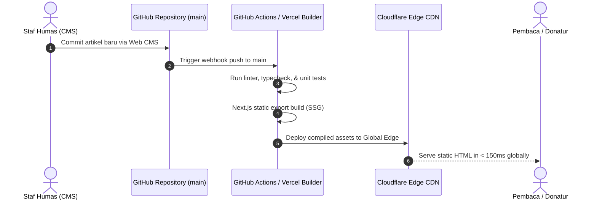

# Panduan Deployment & Operasional: Situs Web Yayasan Bina Karya

```yaml
document_id: DOC-DEPL-002
title: Deployment and Maintenance Guide - Organization Website
version: 1.0.0
hosting_provider: Cloudflare Pages / Vercel (Static Edge Hosting)
domain: binakarya.or.id
status: Active
```

---

## 1. Arsitektur Deployment & Alur CI/CD

Website menggunakan pendekatan **Jamstack** (JavaScript, API, Markup) modern. Seluruh halaman di-compile terlebih dahulu menjadi aset statis murni (HTML, CSS, JS, aset WebP) pada saat proses *build* di pipeline GitHub Actions, kemudian didistribusikan ke ratusan titik edge data center Cloudflare di seluruh dunia.



---

## 2. Konfigurasi Lingkungan (Environment Variables)

Proyek ini tidak menyimpan rahasia server sensitif pada client bundle. Seluruh variabel lingkungan konfigurasi dideklarasikan pada dashboard hosting:

| Variabel | Lingkungan | Deskripsi |
|---|---|---|
| `NEXT_PUBLIC_SITE_URL` | Production | URL basis publik: `https://binakarya.or.id` |
| `NEXT_PUBLIC_TURNSTILE_SITE_KEY` | Production | Public key Cloudflare Turnstile anti-spam untuk formulir kontak |
| `TURNSTILE_SECRET_KEY` | Serverless Function | Secret key validasi captcha token di sisi backend form handler |
| `CONTACT_FORM_FORWARD_EMAIL` | Serverless Function | Alamat email tujuan penerima pesan formulir: `kontak@binakarya.or.id` |

---

## 3. Prosedur Rilis & Quality Gate

Setiap perubahan kode atau artikel harus melalui tahapan verifikasi otomatis sebelum rilis ke production:

1. **Pull Request Preview**: Setiap pull request secara otomatis menghasilkan *Preview Deployment URL* independen untuk ditinjau oleh tim desain dan pengurus yayasan.
2. **Automated Audit CI**: Pipeline CI menjalankan pengujian otomatis:
   ```bash
   # Verifikasi sintaks dan tipe data
   npm run lint
   npm run typecheck

   # Audit performa dan aksesibilitas headless
   npm run test:e2e
   npx lhci autorun
   ```
3. **Merge to Main**: Rilis ke domain live `binakarya.or.id` terjadi secara instan dan tanpa downtime (*atomic deployment*) segera setelah PR di-merge ke branch `main`. Rollback ke versi sebelumnya dapat dilakukan dalam waktu 5 detik melalui tombol "Instant Rollback" pada dashboard hosting.

---

## 4. Jadwal Pemeliharaan & Operasional Rutin

| Frekuensi | Aktivitas Pemeliharaan | Penanggung Jawab |
|---|---|---|
| **Bulanan** | Memeriksa ketersediaan tautan eksternal (*broken link checker*) dan memperbarui dependensi patch keamanan Next.js via Dependabot. | Tim IT Sukarelawan |
| **Kuartalan** | Melakukan audit Google Lighthouse berkala dan meninjau konsumsi bandwidth/kuota gratis hosting. | Tim IT Sukarelawan |
| **Tahunan** | Perpanjangan kepemilikan nama domain `.or.id` ke registrar PANDI (H-30 sebelum kedaluwarsa). | Bendahara & Humas Yayasan |
