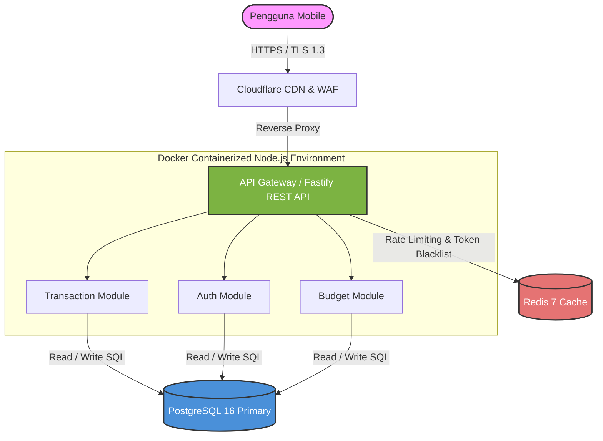
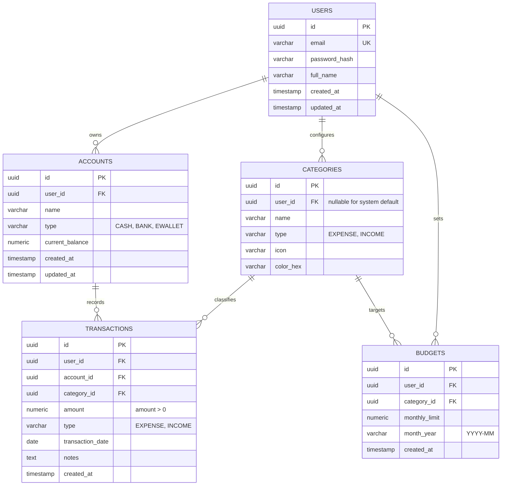

# Spesifikasi Arsitektur Sistem: DompetKu

```yaml
document_id: DOC-ARCH-001
title: System Architecture & Database Design - DompetKu
version: 1.0.0
status: Approved
author: "Lead Systems Architect"
date: 2026-03-20
related_prd: DOC-PRD-001
```

---

## 1. Ikhtisar Arsitektur

DompetKu menggunakan arsitektur **Modular Monolith** berbasis container pada fase MVP. Pilihan ini diambil untuk meminimalkan beban operasional (*operational overhead*) pada tim pengembang kecil, sembari mempertahankan batasan modul domain yang bersih agar mudah diekstrak menjadi microservices jika skala traffic menuntut di masa mendatang.

---

## 2. Diagram C4 Container

Diagram berikut mengilustrasikan batas sistem dan komponen pendukung:



---

## 3. Keputusan Teknologi (ADR Summary)

### 3.1 Framework Backend: Fastify (Node.js/TypeScript)
- **Keputusan**: Menggunakan Fastify daripada Express.js.
- **Rasional**: Fastify memiliki performa throughput 2x lebih tinggi dibanding Express, dilengkapi schema compilation berbasis Ajv yang terintegrasi secara bawaan, serta dukungan first-class untuk TypeScript dan async/await.

### 3.2 Database Utama: PostgreSQL 16
- **Keputusan**: Menggunakan PostgreSQL 16 Relational Database daripada NoSQL (MongoDB).
- **Rasional**: Data finansial membutuhkan integritas data tingkat tinggi, transaksi ACID, foreign key constraints untuk relasi akun-transaksi, dan dukungan indeks B-Tree majemuk untuk penyaringan tanggal.

### 3.3 Cache & Session Layer: Redis 7
- **Keputusan**: Menggunakan Redis standalone untuk rate limiting dan revocation token JWT.
- **Rasional**: Latensi baca in-memory sub-milidetik memastikan pemeriksaan laju request (rate limit) tidak menambah beban latensi pada request API harian.

---

## 4. Desain Database & Skema Relasional (ERD)



---

## 5. Strategi Indexing & Optimasi Query

Untuk menjamin waktu respon `p95 < 200ms` saat tabel transaksi membesar:

1. **`idx_transactions_user_date`**: Indeks majemuk `(user_id, transaction_date DESC, created_at DESC)` pada tabel `TRANSACTIONS`. Mengakselerasi pemanggilan riwayat transaksi berpaginasi.
2. **`idx_transactions_user_category_date`**: Indeks majemuk `(user_id, category_id, transaction_date)` untuk mempercepat perhitungan agregasi pengeluaran per kategori pada fitur anggaran.
3. **`idx_budgets_user_month`**: Indeks unik `(user_id, category_id, month_year)` pada tabel `BUDGETS` untuk mencegah duplikasi batas anggaran pada kategori yang sama di bulan kalender yang sama.

---

## 6. Keamanan & Batas Kepercayaan (Security Architecture)

- **Isolasi Data**: Setiap query transaksi dan akun menyertakan klausa eksplisit `WHERE user_id = :authenticated_user_id` yang diekstrak dari klaim token JWT yang telah diverifikasi di middleware.
- **Enkripsi Kredensial**: Password pengguna di-hash menggunakan algoritma **Argon2id** (memory cost 64MB, time cost 3 iterations, parallelism 1 thread).
- **Rate Limiting**: Diterapkan pada level reverse proxy dan aplikasi (Redis Token Bucket):
  - Endpoint publik / login: Maksimal 5 percobaan per menit per IP address.
  - Endpoint privat / transaksi: Maksimal 120 request per menit per User ID.
- **Audit Logging**: Setiap transaksi mencatat stempel waktu UTC presisi tinggi untuk merekonstruksi mutasi saldo historis jika terjadi rekonsiliasi.
