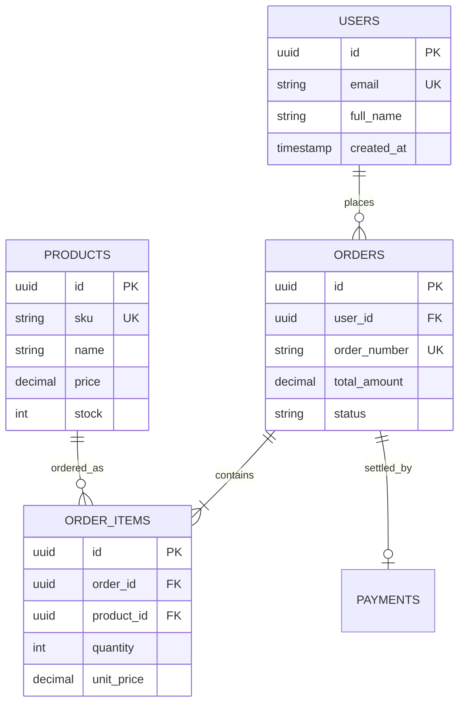

# Database Specification: [Nama Sistem / Database]

> **Panduan Pengisian:**
> Dokumen ini memetakan arsitektur database, relasi entitas, konvensi penamaan, dan prosedur migrasi skema.
> Ditujukan bagi developer backend, DevOps, dan data engineer untuk menjaga konsistensi skema produksi.

---

## 1. Engine & Konfigurasi Instance [Wajib]

> **Panduan Pengisian:**
> Catat spesifikasi engine database target untuk memastikan keseragaman lingkungan lokal, staging, dan produksi.

- **DBMS Engine [Wajib]:** `PostgreSQL` | **Versi Minimum [Wajib]:** `16.2`
- **Character Set [Wajib]:** `UTF8` | **Collation [Wajib]:** `en_US.UTF-8`
- **Timezone Basis Data [Wajib]:** `UTC` (seluruh timestamp aplikasi wajib disimpan dalam format UTC)
- **Koneksi Pooling [Kondisional]:** `PgBouncer` (Max Connections: `100`, Pool Mode: `transaction`)

## 2. Diagram Relasi Entitas (Mermaid ERD) [Wajib]

> **Panduan Pengisian:**
> Perbarui diagram Mermaid berikut sesuai relasi inti sistem. Fokuskan pada entitas domain utama.

## 3. Inventaris Tabel (Table Inventory) [Wajib]

> **Panduan Pengisian:**
> Cantumkan daftar seluruh tabel beserta modul pemilik dan taksiran pertumbuhannya untuk kapasitas storage.

| Nama Tabel Fisik | Modul Domain | Perkiraan Baris Awal | Tingkat Pertumbuhan | Sifat Data |
|---|---|---|---|---|
| `users` | Auth & Identity | < 10.000 | Sedang (~500/bulan) | Master Data |
| `products` | Katalog Produk | < 5.000 | Rendah (~50/bulan) | Master Data |
| `orders` | Penjualan | ~50.000 | Tinggi (~10.000/bulan) | Transaksional |
| `order_items` | Penjualan | ~150.000 | Sangat Tinggi (~30.000/bulan) | Transaksional |
| `audit_logs` | Keamanan & Audit | ~500.000 | Cepat (~100.000/bulan) | Append-Only Log |

## 4. Aturan Integritas Relasional & Konvensi Penamaan [Wajib]

> **Panduan Pengisian:**
> Tentukan konvensi baku penamaan objek dan kebijakan cascade agar struktur database rapi dan aman dari data yatim (*orphaned rows*).

- **Konvensi Penamaan:**
  - Tabel: Huruf kecil jamak (*plural snake_case*), contoh: `user_addresses`, `order_items`.
  - Kolom Primary Key: Selalu bernama `id` bertipe `UUID` atau `BIGINT GENERATED ALWAYS AS IDENTITY`.
  - Kolom Foreign Key: Pola `[singular_table]_[column]`, contoh: `user_id`, `product_id`.
- **Foreign Key Behavior:**
  - Gunakan `ON DELETE RESTRICT` sebagai default untuk data transaksional guna mencegah penghapusan tidak sengaja.
  - Gunakan `ON DELETE CASCADE` hanya pada data anak yang bergantung total pada induknya (contoh: item pesanan terhadap pesanan).
- **Soft-Delete Pattern:**
  - Gunakan kolom nullable `deleted_at TIMESTAMPTZ DEFAULT NULL`.
  - Seluruh query select bisnis wajib memfilter `WHERE deleted_at IS NULL`.

## 5. Strategi Indexing [Wajib]

> **Panduan Pengisian:**
> Catat panduan pembuatan index untuk mencegah kelebihan index (*over-indexing*) yang memperlambat operasi penulisan (*write*).

- **Index Wajib:** Seluruh kolom Foreign Key wajib memiliki index tersendiri untuk mengoptimalkan operasi JOIN.
- **Composite Index:** Urutkan kolom dengan kardinalitas tertinggi di posisi paling kiri (*leftmost prefix rule*).
- **Partial Index:** Gunakan partial index untuk status data yang sering difilter, misal: `WHERE status = 'pending'`.

## 6. Strategi Partisi & Pengarsipan [Opsional] *(Boleh dihapus jika volume data < 10 juta baris)*

> **Panduan Pengisian:**
> Rencanakan pembagian partisi tabel jika volume satu tabel diperkirakan melampaui jutaan baris dalam 1 tahun.

- **Tabel Partisi:** `audit_logs`
- **Metode Partisi:** Partisi rentang waktu bulanan (*Range Partitioning by Month*) berdasarkan kolom `created_at`.
- **Mekanisme Otomatis:** Ekstensi `pg_partman` membuat tabel partisi baru secara otomatis setiap awal bulan.

## 7. Kebijakan Migrasi & Rollback [Wajib]

> **Panduan Pengisian:**
> Tentukan alat bantu migrasi skema dan aturan *zero-downtime deployment* yang wajib dipatuhi tim.

- **Migration Tool [Wajib]:** `[Prisma Migrate / Flyway / Liquibase / Goose]`
- **Aturan Backward-Compatibility:**
  - Dilarang menghapus atau mengubah nama kolom dalam satu langkah migrasi (terapkan skema *Expand & Contract*).
  - Penambahan kolom baru wajib nullable atau memiliki `DEFAULT value` non-blocking.
- **Prosedur Rollback:**
  - Setiap file migrasi naik (`up.sql`) wajib disertai skrip migrasi turun (`down.sql`) yang telah diuji di staging.
