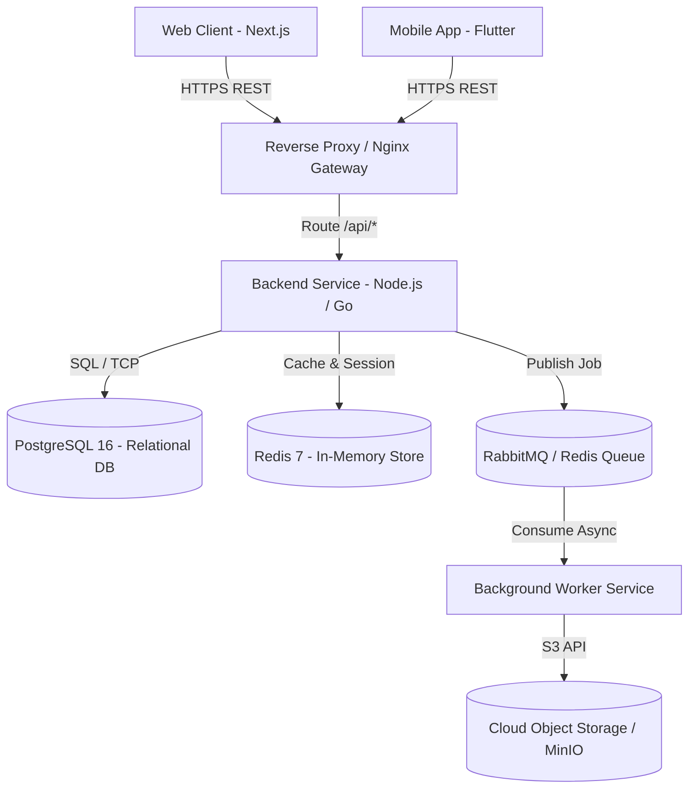

# System Architecture Document: [Nama Sistem]

> **Panduan Pengisian:**
> Dokumen ini mendefinisikan arsitektur tingkat tinggi dan komponen utama sistem piranti lunak.
> Membantu seluruh insinyur memahami batasan sistem, alur data, integrasi teknologi, dan strategi penskalaan.

---

## 1. Gambaran Umum Sistem (System Overview) [Wajib]

> **Panduan Pengisian:**
> Uraikan latar belakang masalah, kapabilitas utama, dan batasan operasional sistem dalam 1-2 paragraf.

[Jelaskan tujuan utama arsitektur, pengguna yang dilayani, dan batasan operasional. Contoh: "Sistem ini merupakan platform e-commerce berbasis modular monolith yang melayani pesanan ritel B2C, terintegrasi langsung dengan payment gateway nasional dan 3 penyedia ekspedisi logistik."]

## 2. Prinsip-Prinsip Arsitektur (Architectural Principles) [Wajib]

> **Panduan Pengisian:**
> Sebutkan 3-5 pedoman dasar yang memandu keputusan desain teknis (misal: stateless, simplicity first).

- **Simplicity First:** Lebih memilih arsitektur *modular monolith* yang matang daripada *microservices* terdistribusi dini.
- **Stateless Compute:** Seluruh kontainer API aplikasi bersifat nir-status (*stateless*) untuk kemudahan autoscaling.
- **Fail Fast & Graceful Degradation:** Kegagalan layanan pihak ketiga (misal: ekspedisi) tidak boleh melumpuhkan alur checkout pelanggan.
- **Data Integrity Over Speed:** Transaksi finansial wajib menggunakan isolasi ACID pada basis data relasional.

## 3. Diagram Arsitektur C4 - Context Level [Wajib]

> **Panduan Pengisian:**
> Gambarkan interaksi tingkat tinggi antara pengguna manusia, sistem ini, dan sistem eksternal di luar organisasi.

```mermaid
graph TD
    User([Pelanggan / Browser & Mobile App]) -->|HTTPS / JSON| System[Sistem Utama: [Nama Proyek]]
    Staff([Admin Internal]) -->|HTTPS / Dashboard| System
    System -->|REST API / Webhook| PaymentGateway[Sistem Payment Gateway Eksternal]
    System -->|REST API| LogisticsProvider[API Logistik & Pengiriman]
    System -->|SMTP / SMS API| NotificationService[Layanan Notifikasi Cloud]
```

## 4. Diagram Arsitektur C4 - Container Level [Wajib]

> **Panduan Pengisian:**
> Gambarkan aplikasi, kontainer, antarmuka, dan penyimpanan data yang membentuk sistem secara internal.



## 5. Matriks Pilihan Teknologi (Tech Stack Matrix) [Wajib]

> **Panduan Pengisian:**
> Catat komponen lapisan sistem, teknologi terpilih, versi yang digunakan, dan justifikasi rasionalnya.

| Lapisan (Layer) | Teknologi | Versi | Rasional Pemilihan |
|---|---|---|---|
| Frontend Web | Next.js (React) | 14.x LTS | Server-Side Rendering untuk performa SEO dan komunitas luas |
| Mobile Client | Flutter | 3.x | Satu basis kode untuk iOS dan Android, efisien bagi tim kecil |
| Backend API | Go (Gin / Chi) | 1.22+ | Utilisasi memori rendah, konkurensi native efisien, binary mandiri |
| Database Utama | PostgreSQL | 16.x | Kehandalan relasional ACID, dukungan tipe data JSONB, dan tooling kaya |
| Cache & Message Broker | Redis | 7.x | Latensi mikrodetik untuk cache kueri dan antrean tugas background |
| Reverse Proxy & CDN | Nginx & Cloudflare | 1.25 / - | Terminasi SSL, kompresi Brotli, proteksi DDoS, dan caching statis |

## 6. Protokol & Pola Komunikasi (Communication Patterns) [Wajib]

> **Panduan Pengisian:**
> Rinci protokol pertukaran data antar-layanan (sinkron vs asinkron) dan format serialisasi yang dipakai.

- **Komunikasi Sinkron (Klien ke Server):** RESTful JSON melalui HTTPS dengan kontrak OpenAPI 3.0.
- **Komunikasi Asinkron (Background Job):** Task queue via Redis Streams untuk operasi berat (pengiriman email, ekspor CSV, pembuatan invoice PDF).
- **Penanganan Webhook:** Webhook masuk dari payment gateway diverifikasi tanda tangan HMAC-SHA256 sebelum diproses ke database.

## 7. Alur Data Tipikal (Typical Data Flow) [Wajib]

> **Panduan Pengisian:**
> Jelaskan langkah berurutan perjalanan data pada transaksi paling penting di sistem.

1. **Request Masuk:** Klien mengirimkan request pembuatan pesanan ke Ingress Gateway.
2. **Validasi & Auth:** Gateway meneruskan request ke Backend; middleware memeriksa JWT token dan sanitasi body request.
3. **Penyimpanan Transaksional:** Backend membuka transaksi DB PostgreSQL, mengunci stok barang, dan mencatat pesanan baru.
4. **Dispatc Tugas Asinkron:** Backend mem-publish event `order.created` ke Redis queue lalu segera mengembalikan status HTTP 201 ke klien.
5. **Pemrosesan Background:** Worker membaca event antrean, menghubungi gateway pembayaran eksternal, dan mengirim email konfirmasi ke pengguna.

## 8. Strategi Penskalaan & Ketersediaan Tinggi (Scaling & HA) [Wajib]

> **Panduan Pengisian:**
> Jelaskan taktik penskalaan horizontal atau vertikal saat menghadapi lonjakan beban pengguna.

- **Penskalaan Horisontal Komputasi:** Backend berjalan di dalam kontainer Docker stateless; replika bertambah otomatis saat beban CPU rata-rata > 70%.
- **Strategi Basis Data:** Menyiapkan 1 Primary Node (Read-Write) dan 1 Read-Replica (Read-Only) untuk memisahkan lalu lintas query pelaporan berat.
- **Caching Layer:** Redis digunakan untuk menampung data katalog produk yang sering dibaca dengan strategi TTL dinamis (15 menit).

## 9. Pemulihan Bencana & Backup (Disaster Recovery) [Opsional] *(Boleh dihapus jika dibahas terpisah)*

> **Panduan Pengisian:**
> Catat frekuensi backup data dan rencana kontinjensi kegagalan infrastruktur total.

- **Cadangan Data:** Snapshot otomatis harian dan arsip Write-Ahead Log (WAL) per 10 menit ke bucket cloud terpisah beda region.
- **Target RPO / RTO:** RPO < 15 menit (kehilangan data maksimal), RTO < 60 menit (pemulihan total layanan baru).
